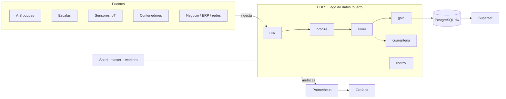

# Arquitectura de la plataforma (plantilla · fase 1)

> Completad y mantened este documento durante todo el proyecto. GitHub dibuja los diagramas `mermaid`.

## 1. Vista general

## 2. Zonas del lago de datos
| Zona | Contenido | Formato | Particionado | Quién escribe | Retención |
|---|---|---|---|---|---|
| raw | Datos tal cual llegan(crudos).No modificables | CSV, Json | NFTS | User | Indefinida - Larga |
| bronze | Los datos de raw pero tipados y en formato columnar | Segun dato | El mmismo | User | Hssta ser usados por la zaona bronze |
| silver | Los datos importantes para el negocio, unificados y eliminado duplicados | Mismo que en bronze | El mismo | User | Hasta ser usados por la zona gold |
| gold | Datos valiosos para toma de decisiones| Mantiene el formato de fase anterior | El mismo | User | Media - Toma de decisiones  |
| cuarentena | Datos que no superan las reglas de calidad | El mismo que en zona anterior | El mismo |  User| Corta |
| control | Metadatos que aseguran todo el sistema| de Peso minimo | El mismo | User | Infinita |

## 3. Fuentes e ingesta
| Fuente | Tipo | Frecuencia real | Volumen/día | Mecanismo propuesto | Idempotente |
|---|---|---|---|---|---|

## 4. Decisiones de diseño (registro)
| Fecha | Decisión | Alternativas | Motivo |
|---|---|---|---|
| 2026-10-14 | Separar raw y bronze | Guardar todo directamente en Parquet | Preservar el dato original tal cual llega para poder reprocesar si hay errores; bronze ya tiene tipos correctos y es eficiente para consultas |
## 5. Componentes y recursos
| Servicio | Función | Réplicas | Memoria |
|---|---|---|---|
| namenode | Indice del sistema de ficheros HDFS | 1 | 1536 MB |
| datanode |  Almacena los bloques de datos de HDFS | 3 | 728 MB c/u |
| spark-master | Es el coordinador del claster Spark | 1 | 1 GB |
| spark-worker | Ejecuta las tareas del Spark | 2 | 2 GB |
| jupyter | Notebook interactivo con PySpark | 1 | 2560 MB |
| hdfs-exporter | Exporta métricas de HDFS a Prometheus (perfil monitor) | 1 | 128 MB |
| node-exporter | Exporta métricas del sistema a Prometheus (perfil monitor) | 1 | 128 MB |
| prometheus | Recolector de métricas (perfil monitor) | 1 | 512 MB |
| grafana | Dashboards de monitorización (perfil monitor) | 1 | 384 MB |
| postgres | Data warehouse puerto_dw (perfil bi) | 1 | 512 MB |
| superset | Visualización de datos (perfil bi) | 1 | 1536 MB |