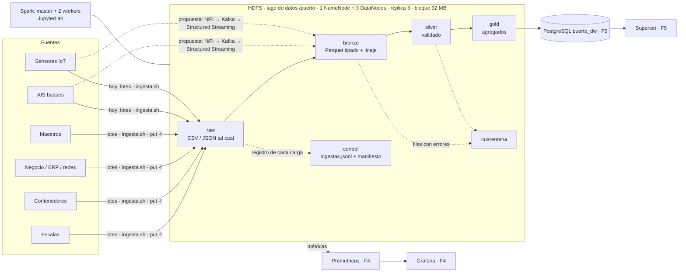

# Arquitectura de la plataforma de datos · Puerto de Huelva

> Documento vivo: se completa y mantiene durante todo el proyecto (última actualización: fase 1).
> GitHub dibuja el diagrama `mermaid` automáticamente.

## 1. Vista general

**Cómo leerlo.** Los datos entran siempre por `raw` sin modificarse. Spark los lee con esquema explícito,
los tipa y los escribe en `bronze` (Parquet, con columnas de linaje). En la fase 3 se validan y limpian en
`silver`, y las consultas de negocio dejan en `gold` tablas pequeñas ya resumidas, que son las que se
presentan a la dirección (y en la fase 5 se cargan en PostgreSQL y Superset). Cada carga deja constancia
en `control`; las filas que no pasan la calidad van a `cuarentena`.

## 2. Zonas del lago de datos

| Zona | Contenido | Formato | Particionado | Quién escribe | Retención |
|---|---|---|---|---|---|
| raw | Datos tal cual llegan de las fuentes (crudos). No se modifican nunca | CSV y JSON Lines: los formatos de texto que generan los sistemas de origen | Sin particionar: una carpeta por fuente (`/puerto/raw/<fuente>`); el dato se guarda tal cual llega | `scripts/hdfs/ingesta.sh` (`hdfs dfs -put -f`) | Permanente e inmutable: es la copia original para poder reprocesar ante cualquier fallo |
| bronze | Los mismos datos que raw, fuertemente tipados (números, fechas, timestamps) y con linaje (`_fichero_origen`, `_ingestado`) | Parquet zstd: columnar, comprimido y con el esquema dentro (elegido con la comparativa de la parte C) | AIS y sensores por `fecha` (las consultas filtran por día y Spark solo lee esa carpeta); escalas por `anio` (≈ 9 escalas/día: por día saldrían ficheros diminutos); contenedores y maestros sin particionar (tablas pequeñas) | Spark (notebook `F1_ingesta_formatos.ipynb`, parte D) | Permanente: histórico consolidado del lago (se puede regenerar desde raw) |
| silver | Datos limpios, deduplicados, coherentes y fiables (reglas de calidad aplicadas) | Parquet zstd | Igual que bronze (por fecha) | Spark (notebook de la fase 3) | Permanente |
| gold | Datos valiosos para la toma de decisiones: tablas pequeñas ya agregadas (tráfico mensual, esperas, navieras, muelles…) | Parquet zstd | Sin particionar: son resúmenes ligeros, optimizados para su consumo directo | Spark (notebook F1 parte E y fase 5) | Mientras los usen los informes; se recalculan desde silver |
| cuarentena | Filas que no superan las reglas de calidad: líneas corruptas (`_corrupto`), fechas o tipos que no se pueden convertir, campos obligatorios vacíos | Parquet, conservando la línea original y el motivo del rechazo | Por fecha de detección | Spark (fase 3) | Temporal (30–90 días): hasta revisar y corregir la causa en el origen |
| control | Metadatos de trazabilidad del lago: registro de ingestas, manifiesto SHA-256 e informes | JSON Lines (`ingestas.jsonl`): una línea por evento, ideal para registros de auditoría | Sin particionar: no guarda datos sino registros administrativos | `ingesta.sh` (registro y manifiesto) y Spark (informes) | Permanente (auditoría) |

## 3. Fuentes e ingesta

Volumen/día = tamaño lógico en `/puerto/raw` (salida de la parte A y de `hdfs dfs -du -h`) ÷ días que cubre
cada fuente según `docs/DICCIONARIO_DATOS.md`.

| Fuente | Tipo | Frecuencia real | Volumen/día | Mecanismo propuesto | Idempotente |
|---|---|---|---|---|---|
| **ais** (`/puerto/raw/ais`) | JSON Lines (semiestructurado) | Tiempo real: posiciones cada pocos segundos por buque (≈ 11 por minuto de media) | ≈ 2,08 MB/día (124,9 MB / 60 días) | Streaming: NiFi → Kafka (topic `puerto-ais-raw`) → Spark Structured Streaming en micro-lotes → bronze por `fecha` | Sí: el *checkpoint* de Spark evita reprocesar o duplicar mensajes |
| **sensores** (`/puerto/raw/sensores`) | CSV (estructurado, formato largo) | Casi tiempo real: cada minuto (meteo, oleaje, aire) y cada 5 min (grúas) | ≈ 1,13 MB/día (67,6 MB / 60 días) | Streaming / micro-lotes: Kafka (topic `puerto-sensores`) → Spark Structured Streaming → bronze por `fecha` | Sí: *checkpoint* de Spark |
| **contenedores** (`/puerto/raw/contenedores`) | CSV (estructurado) | Eventos de terminal durante todo el día (descargas, cargas y puertas) | ≈ 0,11 MB/día (40,7 MB / 365 días) | Lote diario al cierre de jornada desde el sistema de la terminal (TOS) con `ingesta.sh` | Sí: `hdfs dfs -put -f` sobrescribe el lote |
| **negocio** (`/puerto/raw/negocio`) | CSV (`;` y coma decimal en facturas) y JSON Lines (redes, incidencias) | Diaria (facturación, incidencias, redes) y mensual (competencia, tipos de cambio) | ≈ 16,5 KB/día (5,9 MB / 365 días) | Lotes diarios y mensuales: exportación del ERP y APIs con `ingesta.sh` | Sí: `put -f` + registro en `ingestas.jsonl` |
| **escalas** (`/puerto/raw/escalas`) | CSV (estructurado) | Varias veces al día (se actualizan ETA, ATA y ATD) | ≈ 1,5 KB/día (1,1 MB / 731 días, 2024–2025) | Lote diario programado desde el sistema de gestión portuaria con `ingesta.sh` | Sí: `put -f` |
| **maestros** (`/puerto/raw/maestros`) | CSV (catálogos: muelles, navieras, buques) | Esporádica: solo cuando hay altas o cambios | 33,6 KB en total (catálogo estático) | Recarga completa (*full snapshot*) con `ingesta.sh` cuando cambian | Sí: se sustituye el catálogo entero con `put -f` |

## 4. Decisiones de diseño (registro)

| Fecha | Decisión | Alternativas | Motivo |
|---|---|---|---|
| 2026-10-14 | Separar raw y bronze | Guardar todo directamente en Parquet | Conservar el dato original tal cual llega para poder reprocesar si hay errores; bronze ya tiene tipos correctos y es eficiente para consultar |
| 2026-10-14 | Replicación 3 y bloque de 32 MB en HDFS (`docker/hadoop.env`) | Réplica 1–2; bloque de 128 MB | Con 3 DataNodes se tolera la caída de dos nodos sin perder datos (a cambio, el disco ocupado es el triple, comprobado en la parte A). El bloque de 32 MB hace que los ficheros del proyecto ocupen varios bloques, como pasaría a gran escala |
| 2026-10-21 | Ingesta por lotes idempotente con `put -f` y registro en `control` | `put` sin `-f` (falla si el fichero existe); `appendToFile` (duplica datos) | Se puede repetir la ingesta sin miedo; queda constancia de cada carga en `ingestas.jsonl` |
| 2026-10-27 | Propuesta de ingesta continua NiFi → Kafka → Spark Structured Streaming para AIS y sensores | Solo NiFi; Flume; lotes cada hora | Kafka desacopla y guarda los mensajes aunque Spark esté parado; Structured Streaming escribe en el mismo bronze y, con *checkpoint*, no duplica. NiFi gestiona la captura y la contrapresión |
| 2026-10-27 | Leer siempre con esquema explícito | `inferSchema=True` | `inferSchema` lee los datos dos veces y puede equivocarse; con esquema declarado los tipos son los que decidimos |
| 2026-10-27 | Modo `PERMISSIVE` con columna `_corrupto` | `DROPMALFORMED` (descarta en silencio); `FAILFAST` (se para) | No se pierde ninguna línea sin saberlo: se detectaron 735 líneas AIS rotas, que irán a cuarentena en la fase 3 |
| 2026-11-10 | Parquet **zstd** en bronze, silver y gold | Parquet snappy; ORC; Avro; CSV / JSON | Con nuestras mediciones, zstd es el que menos ocupa (7,6 MB frente a 11,3 de snappy y 63,6 de CSV), el que menos tardó en escribir (0,81 s) y el más rápido consultando (0,36 s la consulta completa). Snappy queda como alternativa si importara más ahorrar CPU que espacio |
| 2026-11-10 | Particionar AIS y sensores por `fecha` y escalas por `anio` | Sin particionar; por hora; por buque (`mmsi`) | Las consultas filtran por día y Spark solo lee esas carpetas (*partition pruning*, comprobado con `PartitionFilters`). Por hora o por buque saldrían miles de ficheros pequeños |
| 2026-11-10 | `repartition("fecha")` antes de escribir | Escribir tal cual | Un fichero por día en lugar de uno por tarea y día: evita el problema de los ficheros pequeños en el NameNode |
| 2026-11-10 | Columnas de linaje `_fichero_origen` y `_ingestado` en bronze | No guardar el origen | Permite rastrear cualquier fila errónea hasta el fichero y la carga de los que salió |
| 2026-11-18 | Maestros con esquema declarado y escritos en un solo fichero (`coalesce(1)`) | `inferSchema`; escribir con el reparto por defecto | Son tablas de 12–320 filas: un único fichero evita ficheros pequeños y el esquema garantiza los tipos (calado, eslora, flota…) |

## 5. Componentes y recursos

Tomado de `docker-compose.yml` (límite de memoria `mem_limit`).

| Servicio | Función | Réplicas | Memoria (límite) | Perfil |
|---|---|---|---|---|
| namenode | Maestro de HDFS: gestiona el árbol de directorios, los metadatos y la ubicación de los bloques (no guarda datos) | 1 | 1536 MB | núcleo |
| datanode | Almacena los bloques físicos de datos y sus réplicas en disco | 3 | 768 MB cada uno (2304 MB) | núcleo |
| spark-master | Coordinador del clúster Spark: reparte los recursos y coordina a los workers | 1 | 1 GB | núcleo |
| spark-worker | Ejecuta las tareas de Spark (2 núcleos y 1536 MB para tareas cada uno) | 2 | 2 GB cada uno (4 GB) | núcleo |
| jupyter | JupyterLab con PySpark: notebooks interactivos y *driver* de Spark | 1 | 2560 MB | núcleo |
| hdfs-exporter | Exporta métricas de HDFS a Prometheus: DataNodes vivos, bloques sin réplica suficiente y frescura de los datos que entran | 1 | 128 MB | monitor (F4) |
| node-exporter | Exporta métricas del equipo anfitrión (CPU, RAM, disco) a Prometheus | 1 | 128 MB | monitor (F4) |
| prometheus | Base de datos de series temporales con las métricas (15 días) | 1 | 512 MB | monitor (F4) |
| grafana | Paneles para vigilar la salud técnica del clúster | 1 | 384 MB | monitor (F4) |
| postgres | Almacén relacional `puerto_dw` que recibe las tablas de negocio de la capa gold | 1 | 512 MB | bi (F5) |
| superset | Herramienta de inteligencia de negocio (BI) para la visualización ejecutiva, conectada a PostgreSQL | 1 | 1536 MB | bi (F5) |

**Suma del núcleo:** 1536 + 3 × 768 + 1024 + 2 × 2048 + 2560 = **11 520 MB (≈ 11,3 GB)**. Es algo más que los
10 GB asignados a WSL en `.wslconfig`, pero `mem_limit` es un techo, no una reserva: los servicios casi nunca
llegan a su límite a la vez. Arrancar a la vez los perfiles `monitor` y `bi` (+3,2 GB) sí podría agotar la
memoria; por eso cada perfil se arranca solo en su fase.

## 6. Retención, seguridad y coste

- **Retención.** raw y control son permanentes (original y auditoría). bronze y gold se pueden regenerar
  desde raw, así que en un clúster real podrían guardarse menos tiempo para ahorrar disco. La cuarentena se
  vacía a los 30–90 días, una vez corregido el origen.
- **Seguridad.** Todos los puertos se publican solo en `127.0.0.1` (no son accesibles desde la red del aula).
  En el laboratorio los permisos de HDFS están desactivados (`dfs.permissions.enabled=false`); en producción
  se activarían con Kerberos. Las contraseñas del `docker-compose.yml` son de laboratorio y en producción
  irían en un gestor de secretos. Los datos generados no se suben a Git (`.gitignore`) y son simulados: no
  contienen datos personales reales.
- **Coste.** La replicación 3 triplica el disco: los 240 MB de raw ocupan unos 720 MB. Usar Parquet lo
  compensa con creces: AIS pasa de 124,8 MB en JSON a 7,6 MB en Parquet zstd, unas 16 veces menos, así que
  incluso con tres réplicas ocupa menos que una sola copia en JSON.
