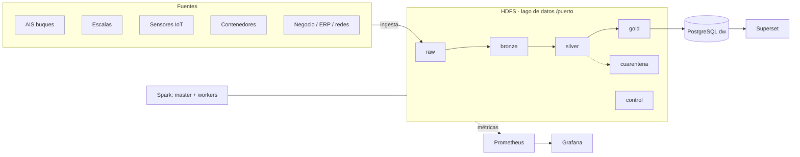

# Arquitectura de la plataforma (plantilla · fase 1)

> Completad y mantened este documento durante todo el proyecto. GitHub dibuja los diagramas `mermaid`.

## 1. Vista general

## 2. Zonas del lago de datos
| Zona | Contenido | Formato | Particionado | Quién escribe | Retención |
|---|---|---|---|---|---|
| raw | Datos tal cual llegan(crudos).No modificables | CSV, Json | NFTS | User | Indefinida - Larga |
| bronze | Los datos de raw pero tipados y en formato columnar | Segun dato | El mmismo | User | Hssta ser usados por la zaona bronze |
| silver | Los datos importantes para el negocio, unificados y eliminado duplicados | Mismo que en bronze | El mismo | User | Hasta ser usados por la zona gold |
| gold | Datos valiosos para toma de decisiones| Mantiene el formato de fase anterior | El mismo | User | Media - Toma de decisiones  |
| cuarentena | Datos que no superan las reglas de calidad | El mismo que en zona anterior | El mismo |  User| Corta |
| control | Metadatos que aseguran todo el sistema| de Peso minimo | El mismo | User | Infinita |

## 3. Fuentes e ingesta
| Fuente | Tipo | Frecuencia real | Volumen/día | Mecanismo propuesto | Idempotente |
|---|---|---|---|---|---|

## 4. Decisiones de diseño (registro)
| Fecha | Decisión | Alternativas | Motivo |
|---|---|---|---|

## 5. Componentes y recursos
| Servicio | Función | Réplicas | Memoria |
|---|---|---|---|
