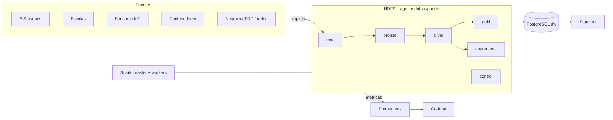

# Arquitectura de la plataforma (plantilla · fase 1)

> Completad y mantened este documento durante todo el proyecto. GitHub dibuja los diagramas `mermaid`.

## 1. Vista general

## 2. Zonas del lago de datos
| Zona | Contenido | Formato | Particionado | Quién escribe | Retención |
|---|---|---|---|---|---|
| raw | Datos tal cual llegan de las fuentes (AIS, escalas, sensores, contenedores, maestros) | CSV / JSON originales | Sin particionar (carpeta por fuente) | `ingesta.sh` | Permanente (histórico) |
| bronze | Mismos datos que raw, con tipos correctos y sin inferencia de esquema | Parquet | Por fecha (AIS, sensores) y por año (escalas) | Notebook `F1_ingesta_formatos.ipynb` | Permanente (varios años) |
| silver | Datos limpios y validados: sin nulos, sin duplicados, reglas de negocio aplicadas | Parquet | Por fecha (según consultas) | Notebook (fase 3) | Permanente |
| gold | Resúmenes listos para negocio: tablas pequeñas ya agregadas | Parquet | Sin particionar (tablas pequeñas) | Notebook parte E | Permanente |
| cuarentena | Filas con errores: registros corruptos, tipos inválidos, campos obligatorios vacíos | Parquet (con columna `_corrupto`) | Por fecha | Notebook (al detectar errores) | 30–90 días |
| control | Registro de qué se ha cargado, cuándo y desde dónde | JSON Lines (`.jsonl`) | Sin particionar | `ingesta.sh` | Permanente |

## 3. Fuentes e ingesta
| Fuente | Tipo | Frecuencia real | Volumen/día | Mecanismo propuesto | Idempotente |
|---|---|---|---|---|---|
| AIS | Streaming | Continua (cada pocos segundos) | ~2.08 MB/día | Kafka + Spark Structured Streaming | Sí (`put -f`) |
| Escalas | Lotes | Diaria | ~0.02 MB/día | Ingesta batch diaria con `ingesta.sh` | Sí (`put -f`) |
| Sensores | Streaming | Continua (cada minuto) | ~1.12 MB/día | Kafka + Spark Structured Streaming | Sí (`put -f`) |
| Contenedores | Lotes | Por llegada de buque | ~0.68 MB/día | Ingesta batch con `ingesta.sh` | Sí (`put -f`) |
| Negocio | Lotes | Semanal / Mensual | ~0.10 MB/día | Exportación ERP + `ingesta.sh` | Sí (`put -f`) |
| Maestros | Lotes | Esporádica (cambios raros) | ~0.01 MB/día | Ingesta batch con `ingesta.sh` | Sí (`put -f`) |

## 4. Decisiones de diseño (registro)
| Fecha | Decisión | Alternativas | Motivo |
|---|---|---|---|
| 2026-11-03 | Separar raw y bronze | Guardar todo directamente en Parquet | Preservar el dato original tal cual llega para poder reprocesar si hay errores; bronze ya tiene tipos correctos y es eficiente para consultas |
| 2026-11-03 | Usar Parquet en bronze, silver y gold | CSV, JSON, Avro, ORC | Formato columnar: ocupa menos, las consultas leen solo las columnas necesarias y guarda el esquema embebido |

## 5. Componentes y recursos
| Servicio | Función | Réplicas | Memoria |
|---|---|---|---|
| namenode | Índice del sistema de ficheros HDFS | 1 | 1536 MB |
| datanode | Almacena los bloques de datos de HDFS | 3 | 768 MB cada uno |
| spark-master | Coordinador del clúster Spark | 1 | 1 GB |
| spark-worker | Ejecuta las tareas de Spark | 2 | 2 GB cada uno |
| jupyter | Notebooks interactivos con PySpark | 1 | 2560 MB |
| hdfs-exporter | Exporta métricas de HDFS a Prometheus | 1 | 128 MB |
| node-exporter | Exporta métricas del sistema a Prometheus | 1 | 128 MB |
| prometheus | Recolector de métricas | 1 | 512 MB |
| grafana | Dashboards de monitorización | 1 | 384 MB |
| postgres | Data warehouse `puerto_dw` | 1 | 512 MB |
| superset | Visualización de datos (BI) | 1 | 1536 MB |