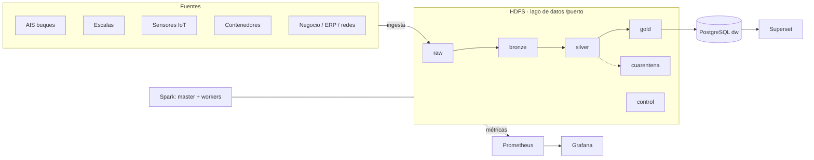

# Arquitectura de la plataforma (plantilla · fase 1)

> Completad y mantened este documento durante todo el proyecto. GitHub dibuja los diagramas `mermaid`.

## 1. Vista general

## 2. Zonas del lago de datos
| Zona | Contenido | Formato | Particionado | Quién escribe | Retención |
|---|---|---|---|---|---|
| raw | Datos tal cual llegan(crudos).No modificables | CSV, Json. Formatos universales de texto plano estructurados o semiestructurados generados por las fuentes nativas | Sin particionar, el dato se almacena tal cual llega | El script automatizado *ingesta.sh* se encarga  de la carga de los datos al HDFS| Permanente e inmutable, actua como copia de seguridad ante cualquier fallo |
| bronze | Los datos de raw pero fuertemente tipados  | Parquet, es un formato optimizado que comprime mucho el espacio y acelera las lecturas | Por fecha/año(datos físicos divididos en subcarpetas por fecha). Cuando Spark consulta filtrando por una fecha concreta, lee la carpeta asociada y descarta el resto | Spark es el motor de procesamiento distribuido encargado de leer los ficheros de raw, tiparlos y escribirlos masivamente en bronze | Permanente, forma parte del histórico consolidado del lago |
| silver | Los datos limpios y deduplicados, coherentes y fiables | Parquet | Particionado por fecha | Spark | Permanente |
| gold | Datos valiosos para toma de decisiones| Parquet | Sin particionar, aqui las tablas de datos son pequeñas y ligeras(contienen resúmenes), se guardan optimizadas para su consumo directo | Apache Spark | Permanente, son consulatdos por Bi o bases de datos |
| cuarentena | Datos que no superan las reglas de calidad, datos incoherentes o incompletos | CSV / JSON | Sin particionar | Apache Spark | Temporal, hasta que se revisan las causas de estos datos incoherentes |
| control | Metadatos que registran la trazabilidad administrativa del lago | JSONL - JSON Lines, ideal para registrar lineas de eventos o logs de auditoría | Sin particionar,no almacena datos sino registros administrativos, manifiestos e informes de ingesta | Script ingesta y Apache Spark | Permanente |

## 3. Fuentes e ingesta
| Fuente | Tipo | Frecuencia real | Volumen/día | Mecanismo propuesto | Idempotente |
|---|---|---|---|---|---|

## 4. Decisiones de diseño (registro)
| Fecha | Decisión | Alternativas | Motivo |
|---|---|---|---|
| 2026-10-14 | Separar raw y bronze | Guardar todo directamente en Parquet | Preservar el dato original tal cual llega para poder reprocesar si hay errores; bronze ya tiene tipos correctos y es eficiente para consultas |
## 5. Componentes y recursos
| Servicio | Función | Réplicas | Memoria |
|---|---|---|---|
| namenode | Maestro de HDFS: gestiona el árbol de directorios, metadatos y ubicación de bloques | 1 | 1536 MB |
| datanode |  Almacena los bloques físicos de datos y sus réplicas en disco | 3 | 728 MB c/u = 2304 MB |
| spark-master | Es el coordinador del clúster Spark: reparte los recursos y coordina a los workers | 1 | 1 GB |
| spark-worker | Ejecuta las tareas del Spark | 2 | 2 GB |
| jupyter | Notebook interactivo con PySpark | 1 | 2560 MB |
| hdfs-exporter | Exporta métricas de HDFS a Prometheus (vigila la salud de los datos de Hadoop, si los 3 DataNodes siguen vivos, si faltan réplicas de bloques y si siguen entrando ficheros al lago) | 1 | 128 MB |
| node-exporter | Exporta métricas del sistema(ordenador o servidor base donde está corriendo todo, vigila la salud de la CPU, RAM y disco duro del PC) a Prometheus (perfil monitor) | 1 | 128 MB |
| prometheus | Base de datos de series temporales que almacenan las métricas de monitorización | 1 | 512 MB |
| grafana | Dashboards para monitorizar la salud técnica del clúster | 1 | 384 MB |
| postgres | Almacen relacionalD (puerto_dw) que recibe las tablas de negocio desde la capa Gold | 1 | 512 MB |
| superset | Herramienta de Business Intelligence (BI) para visualización ejecutiva conectada a PostgreSQL | 1 | 1536 MB |