# Memoria de la fase 1 · Diseño del centro de datos e ingesta (RA1)

> Pareja 04 · Proyecto «Plataforma de datos del Puerto de Huelva» · Big Data Aplicado (05075) · IES La Marisma

## 0. Datos de la pareja

| | Miembro 1 | Miembro 2 | Miembro 3 |
|---|---|---|---|
| Nombre | José Antonio Rodríguez | Ana Cárdenas | Hugo Pérez |
| Usuario de GitHub | joseGS10 | annamcardenas | Hugopdam |
| Partes de las que es responsable principal | Etapas 0–3: entorno, primera versión de la arquitectura, exploración de HDFS (parte A) e ingesta y lectura con esquema (parte B) | Etapas 4–6: comparativa de formatos (parte C), zona bronze (parte D), consultas de negocio (parte E) y ejecución final del cuaderno | Etapa 7: informe para la dirección (parte F); redacción de la memoria y de `docs/ARQUITECTURA.md` |

**Horas dedicadas aproximadas:** 35 (entre los tres) · **Commit final:** el que señala el tag `F1-entrega`

> **Nota sobre las evidencias.** Las etapas 0–3 se hicieron y capturaron en el PC de José (el sello indica
> «PC MSI»). El cuaderno entregado se ejecutó completo, de principio a fin, en el PC de Ana el 18/11/2026
> («PC AMY»), y las capturas de las etapas 4–6 salen de esa ejecución. Los datos son los mismos en los dos
> PC (generador con semilla fija), y por eso las cifras de las partes A y B coinciden.

## 1. Resumen

Hemos diseñado y construido el lago de datos del Puerto de Huelva sobre un clúster en Docker (HDFS con
1 NameNode y 3 DataNodes, Spark con 2 workers y JupyterLab). El lago tiene seis zonas (raw, bronze, silver,
gold, cuarentena y control). Hemos cargado por lotes unos 240 MB de datos simulados con `ingesta.sh` y
proponemos una ingesta continua con NiFi, Kafka y Spark Structured Streaming para AIS y sensores. Leemos
siempre con esquema explícito, sin perder las 735 líneas AIS corruptas ni las 151 fechas de factura mal
formadas. La comparativa de seis formatos nos ha llevado a Parquet zstd, que ocupa 8 veces menos que CSV
y consulta varias veces más rápido. Con ello hemos creado la zona bronze de todas las fuentes, 7 tablas de
negocio en gold y un informe para la dirección sobre el aumento de la espera de los portacontenedores.

## 2. Desarrollo por criterio de evaluación

### CE1.a · Diseño de la solución de almacenamiento

#### Entorno funcionando (etapa 0)

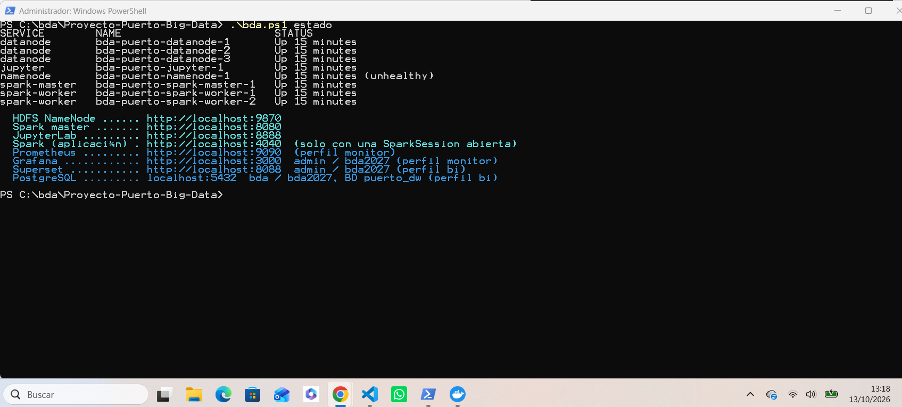
*Salida de `.\bda.ps1 estado`: los 3 DataNodes, el NameNode, el master, los 2 workers de Spark y Jupyter arrancados (`Up`).*

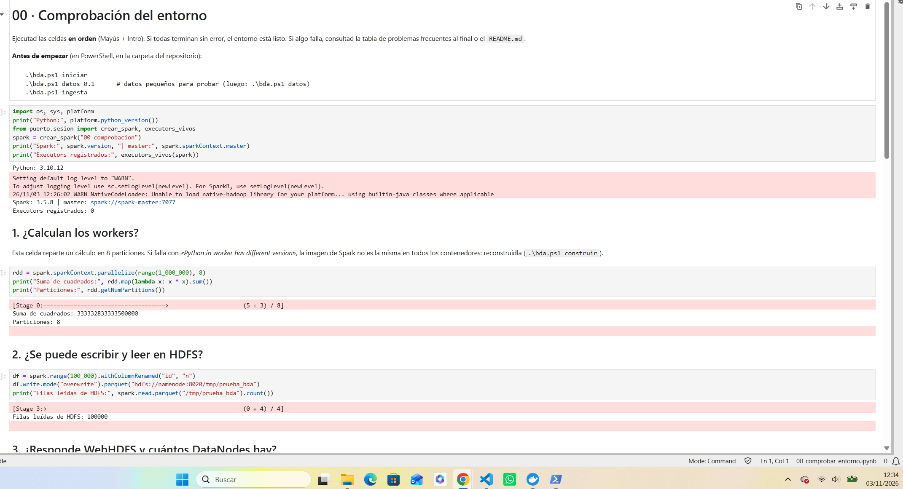
*Cuaderno `00_comprobar_entorno.ipynb`: Spark 3.5.8 conectado al master, cálculo repartido en 8 particiones y lectura/escritura de 100 000 filas en HDFS.*

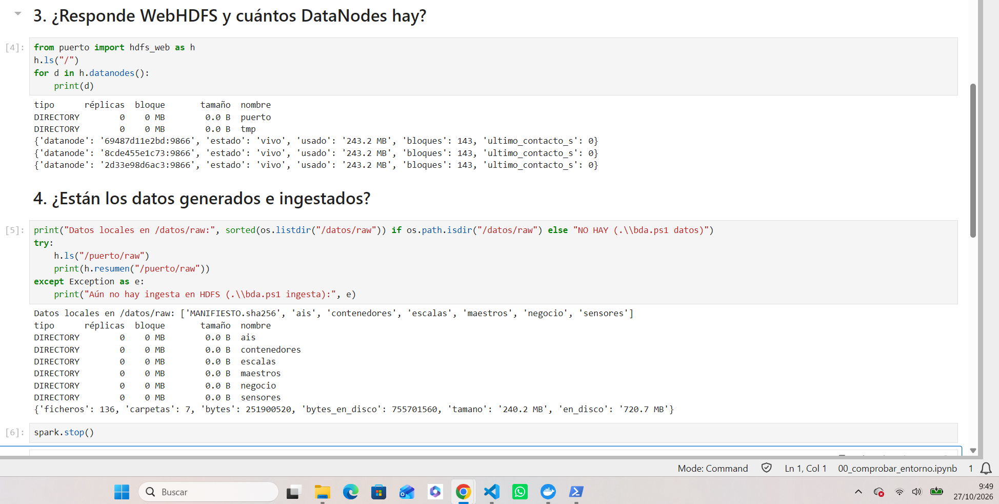
*Final del cuaderno 00 sin errores: WebHDFS responde, los 3 DataNodes están vivos y los datos están ingestados en `/puerto/raw` (240,2 MB lógicos, 720,7 MB en disco).*

#### Diseño del lago (etapa 1)

El diseño completo está en [`docs/ARQUITECTURA.md`](../../docs/ARQUITECTURA.md): diagrama de flujos, zonas,
fuentes, registro de 11 decisiones con sus alternativas, componentes y consideraciones de retención,
seguridad y coste. Resumen de las zonas:

| Zona | Contenido | Formato | Particionado | Quién escribe | Retención |
|---|---|---|---|---|---|
| raw | Datos tal cual llegan | CSV / JSON Lines | Carpeta por fuente | `ingesta.sh` | Permanente e inmutable |
| bronze | Mismos datos tipados + linaje | Parquet zstd | AIS y sensores por `fecha`, escalas por `anio` | Spark, parte D | Permanente |
| silver | Datos validados y limpios | Parquet zstd | Por fecha | Spark, fase 3 | Permanente |
| gold | Agregados de negocio | Parquet zstd | Sin particionar | Spark, parte E | Mientras se usen |
| cuarentena | Filas que no pasan la calidad | Parquet + motivo | Por fecha de detección | Spark, fase 3 | 30–90 días |
| control | Registro de ingestas y manifiesto | JSON Lines | Sin particionar | `ingesta.sh` | Permanente |

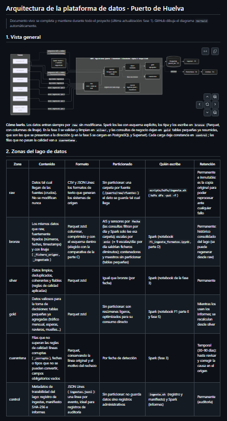
*`docs/ARQUITECTURA.md` visto en GitHub: diagrama mermaid dibujado y tabla de zonas.*

#### Estructura en HDFS (etapa 2 · parte A)

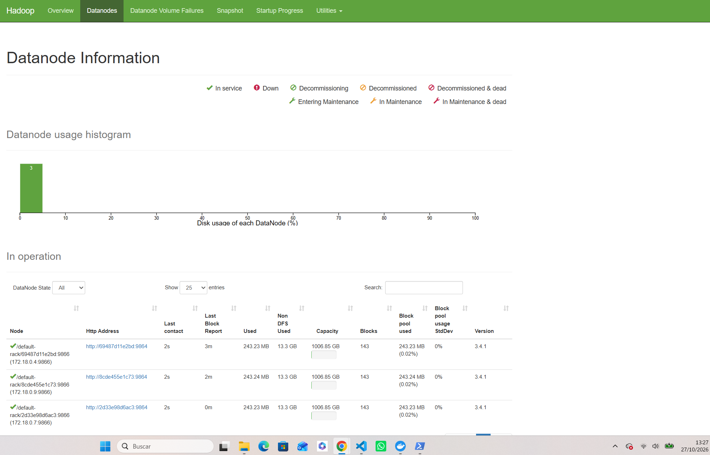
*Pestaña Datanodes del NameNode (localhost:9870): 3 DataNodes «In service», con 143 bloques y 243 MB usados cada uno.*

```powershell
.\bda.ps1 hdfs dfs -du -h /puerto/raw
```

```
124.9 M  374.6 M  /puerto/raw/ais
40.7 M   122.1 M  /puerto/raw/contenedores
1.1 M    3.3 M    /puerto/raw/escalas
33.6 K   100.7 K  /puerto/raw/maestros
5.9 M    17.7 M   /puerto/raw/negocio
67.6 M   202.9 M  /puerto/raw/sensores
```

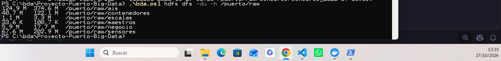
*Salida de `hdfs dfs -du -h /puerto/raw`: la primera columna es el tamaño lógico y la segunda el espacio en disco.*

Salida de la parte A del cuaderno:

```
maestros         3 ficheros     33.6 KB lógicos    100.7 KB en disco
escalas          2 ficheros      1.1 MB lógicos      3.3 MB en disco
negocio         10 ficheros      5.9 MB lógicos     17.7 MB en disco
contenedores     1 ficheros     40.7 MB lógicos    122.1 MB en disco
sensores        60 ficheros     67.6 MB lógicos    202.9 MB en disco
ais             60 ficheros    124.9 MB lógicos    374.6 MB en disco
```

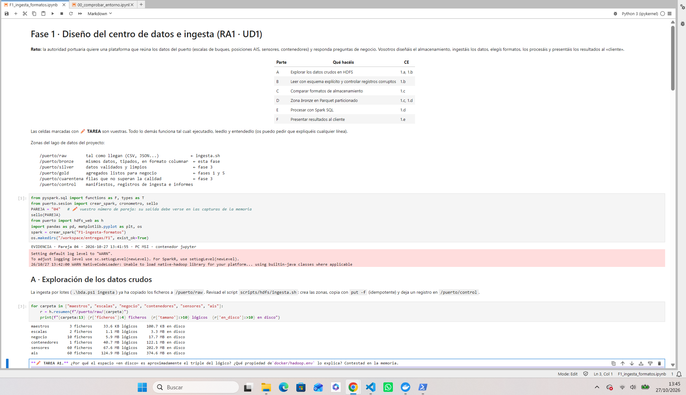
*Sello de la pareja 04 y tabla de la parte A con los ficheros, el tamaño lógico y el espacio en disco de cada fuente.*

**TAREA A1 · ¿Por qué «en disco» es el triple del lógico?** Para garantizar la tolerancia a fallos. En
`docker/hadoop.env` está la propiedad `dfs.replication=3`: HDFS guarda automáticamente 3 copias idénticas de
cada bloque en DataNodes distintos, así que si un nodo se cae los datos siguen disponibles. Con nuestros
números: AIS ocupa 124,9 MB de datos y 374,6 MB en disco (124,9 × 3 = 374,7); en total, los 240,2 MB de raw
ocupan 720,7 MB. El NameNode no guarda los datos: solo el índice de qué bloques forman cada fichero y en qué
DataNodes está cada copia.

En el mismo fichero, `dfs.blocksize=33554432` fija bloques de 32 MB, así que AIS (124,9 MB) ocupa varios
bloques. Un detalle que hemos observado: los ficheros que escribe Spark aparecen con bloque de 128 MB
(columna «bloque» del listado de bronze). La configuración de `hadoop.env` la leen los servicios de HDFS,
pero el cliente de Spark usa su valor por defecto. Lo revisaremos en la fase 2, dedicada a bloques y réplicas.

### CE1.b · Ingesta de datos

#### Cómo funciona `ingesta.sh` (etapa 3)

El script (`scripts/hdfs/ingesta.sh`) se ejecuta dentro del NameNode con `.\bda.ps1 ingesta` y automatiza la
carga desde el disco local (`/datos/raw`) hacia HDFS en tres pasos:

1. **Crea las zonas del lago** con `hdfs dfs -mkdir -p`: `/puerto/raw`, `bronze`, `silver`, `gold`,
   `cuarentena` y `control`. Antes comprueba que existen los datos (el fichero `MANIFIESTO.sha256`).
2. **Copia cada fuente** (maestros, escalas, negocio, contenedores, sensores y ais) a `/puerto/raw/<fuente>`
   con `hdfs dfs -put -f`. La opción `-f` (*force*) sobrescribe si el fichero ya existe, así que repetir la
   ingesta deja exactamente el mismo estado sin duplicar datos: es **idempotente**. También copia el
   manifiesto SHA-256 a `/puerto/control` para poder verificar la integridad.
3. **Registra la ejecución** añadiendo una línea JSON a `/puerto/control/ingestas.jsonl` con la fecha, el
   origen, el destino y los segundos que ha tardado.

```powershell
.\bda.ps1 hdfs dfs -cat /puerto/control/ingestas.jsonl
```

```
{"fecha":"2026-10-21T16:45:39+0000","origen":"/datos/raw","destino":"/puerto/raw","segundos":57}
{"fecha":"2026-10-27T08:31:20+0000","origen":"/datos/raw","destino":"/puerto/raw","segundos":58}
```

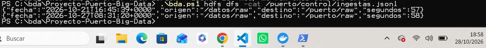
*Registro de ingestas en `/puerto/control`: dos cargas completas de unos 57 s; la segunda no duplicó datos gracias a `put -f`.*

#### TAREA A2 · Tabla de fuentes

Volumen/día = tamaño lógico en raw ÷ días que cubre cada fuente según `docs/DICCIONARIO_DATOS.md`.

| Fuente | Tipo | Frecuencia real | Volumen/día | Mecanismo propuesto | Idempotente |
|---|---|---|---|---|---|
| ais | JSON Lines | Tiempo real: cada pocos segundos por buque | ≈ 2,08 MB (124,9 MB / 60 días) | Streaming: NiFi → Kafka → Spark Structured Streaming | Sí (*checkpoint* de Spark) |
| sensores | CSV formato largo | Cada minuto (meteo, oleaje, aire) y cada 5 min (grúas) | ≈ 1,13 MB (67,6 MB / 60 días) | Micro-lotes: Kafka → Spark Structured Streaming | Sí (*checkpoint* de Spark) |
| contenedores | CSV | Eventos de terminal durante todo el día | ≈ 0,11 MB (40,7 MB / 365 días) | Lote diario al cierre desde el sistema de terminal (TOS) | Sí (`put -f`) |
| negocio | CSV y JSON Lines | Diaria (facturas, incidencias, redes) y mensual (competencia, cambio) | ≈ 16,5 KB (5,9 MB / 365 días) | Lotes diarios y mensuales desde el ERP y APIs | Sí (`put -f`) |
| escalas | CSV | Varias veces al día (ETA, ATA, ATD) | ≈ 1,5 KB (1,1 MB / 731 días) | Lote diario desde el sistema portuario | Sí (`put -f`) |
| maestros | CSV (catálogos) | Esporádica (altas o cambios) | 33,6 KB en total | Recarga completa (*full snapshot*) | Sí (`put -f`) |

#### Propuesta de ingesta incremental para AIS

Las antenas AIS reciben posiciones de los buques cada pocos segundos (≈ 945 000 en 60 días, unas 11 por
minuto de media), así que cargarlas en lotes diarios supone horas de retraso. Proponemos una ingesta en tiempo
real con tres componentes:

1. **Apache NiFi** se conecta a las estaciones receptoras, captura las tramas, valida su estructura inicial y
   gestiona las colas con control de contrapresión (*backpressure*) si llegan más mensajes de los que se
   pueden procesar.
2. **Apache Kafka** actúa como bus de mensajes desacoplado (topic `puerto-ais-raw`). Absorbe los picos de
   tráfico y guarda los mensajes unos días aunque Spark esté parado, sin perder eventos.
3. **Spark Structured Streaming** consume el topic en micro-lotes (por ejemplo, de 1 minuto), aplica el mismo
   esquema explícito de la parte B, separa las líneas corruptas hacia la cuarentena y añade los datos a
   `/puerto/bronze/ais` en Parquet, en la carpeta `fecha=AAAA-MM-DD` que corresponda.

La **idempotencia** la da el *checkpoint* de Spark: guarda hasta qué mensaje de Kafka ha procesado y, si el
trabajo falla, continúa desde ahí sin duplicar (*exactly-once*). Como un micro-lote por minuto crearía
1 440 ficheros diarios por partición, habría que **compactar cada noche** el día anterior en un solo fichero.

El script `scripts/hdfs/simular_llegada_ais.sh` muestra la idea: deja un fichero AIS nuevo en
`/puerto/landing/ais` cada N segundos (60 por defecto), como si llegaran de forma continua. En la propuesta,
esa carpeta de *landing* la sustituiría el topic de Kafka. En la fase 4 se usará para vigilar la frescura de
los datos.

#### Lectura con esquema explícito y registros corruptos (parte B)

Leemos AIS con esquema declarado y en modo `PERMISSIVE` con `columnNameOfCorruptRecord="_corrupto"`. En lugar
de pararse (`FAILFAST`) o descartar las líneas en silencio (`DROPMALFORMED`), Spark guarda en la columna
`_corrupto` las líneas que no puede interpretar:

```
Posiciones AIS: 945371
Líneas corruptas: 735
```

Son el 0,08 % del total: líneas JSON cortadas a mitad, por ejemplo `{"mmsi":"224546912","ts":`. Para la
comparativa y la zona bronze nos quedamos con las 944 636 válidas (`_corrupto IS NULL`); en la fase 3 las
corruptas irán a la cuarentena.

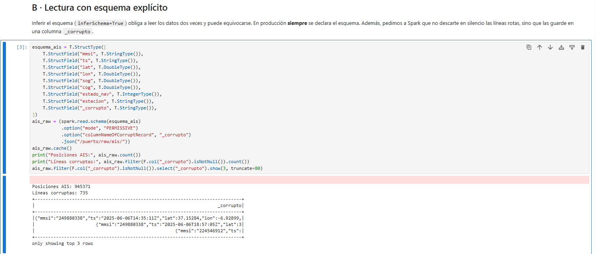
*Lectura de AIS con esquema explícito: 945 371 posiciones, 735 líneas corruptas y tres ejemplos de líneas cortadas.*

Las escalas también se leen con esquema declarado (17 columnas, con `toneladas` como `double` y `teu` y
`pasajeros` como `integer`). Al mostrar las primeras filas aparecen fechas `ata` en dos formatos distintos
(`2024-01-01 11:48:34` y `01/01/2024 07:08`): por eso, al pasarlas a bronze, se prueban los dos con `coalesce`.

#### TAREA B1 · Facturas con esquema de texto

`facturas_2025.csv` es una exportación de un ERP español: separador `;`, coma decimal y fechas `dd/MM/yyyy`.
Con un esquema explícito Spark asigna las columnas **por posición**, así que primero comprobamos la cabecera
real del fichero y declaramos las 11 columnas en ese orden, todas como texto. Después convertimos nosotros los
tipos:

```python
columnas_facturas = ["num_factura", "linea", "fecha", "id_cliente", "cod_servicio", "cantidad",
                     "precio_unitario", "descuento_pct", "importe", "divisa", "comercial"]
esquema_facturas = T.StructType([T.StructField(c, T.StringType()) for c in columnas_facturas])

facturas_raw = (spark.read.schema(esquema_facturas)
                .option("header", True).option("sep", ";")
                .csv("/puerto/raw/negocio/facturas_2025.csv"))

def a_numero(c):
    return F.regexp_replace(F.col(c), ",", ".").cast("double")

facturas = (facturas_raw
    .withColumn("linea", F.col("linea").cast("int"))
    .withColumn("fecha", F.to_date("fecha", "dd/MM/yyyy"))
    .withColumn("cantidad", a_numero("cantidad"))
    .withColumn("precio_unitario", a_numero("precio_unitario"))
    .withColumn("descuento_pct", a_numero("descuento_pct"))
    .withColumn("importe", a_numero("importe")))
facturas.show(5, truncate=False)
facturas.printSchema()
```

```
+------------+-----+----------+----------+------------+--------+---------------+-------------+-------+------+----------+
|num_factura |linea|fecha     |id_cliente|cod_servicio|cantidad|precio_unitario|descuento_pct|importe|divisa|comercial |
+------------+-----+----------+----------+------------+--------+---------------+-------------+-------+------+----------+
|F2025-000001|1    |2025-08-09|CLI0385   |S11         |97.28   |26.3           |10.0         |2302.62|EUR   |C02-Javier|
|F2025-000002|1    |2025-07-19|CLI0105   |S10         |954.43  |8.33           |5.0          |7552.88|EUR   |C02-Javier|
|F2025-000002|2    |2025-07-19|CLI0105   |S14         |5.0     |222.94         |5.0          |1058.96|EUR   |C04-Andrés|
|F2025-000002|3    |2025-07-19|CLI0105   |S10         |236.11  |9.02           |15.0         |1810.26|EUR   |C03-Lucía |
|F2025-000002|4    |2025-07-19|CLI0105   |S13         |1.0     |701.06         |0.0          |701.06 |EUR   |C05-Rocío |
+------------+-----+----------+----------+------------+--------+---------------+-------------+-------+------+----------+

root
 |-- num_factura: string (nullable = true)
 |-- linea: integer (nullable = true)
 |-- fecha: date (nullable = true)
 |-- id_cliente: string (nullable = true)
 |-- cod_servicio: string (nullable = true)
 |-- cantidad: double (nullable = true)
 |-- precio_unitario: double (nullable = true)
 |-- descuento_pct: double (nullable = true)
 |-- importe: double (nullable = true)
 |-- divisa: string (nullable = true)
 |-- comercial: string (nullable = true)

Líneas de factura: 30127
+-----------+--------------+---------------------+-------------------+-------------+
|fallo_fecha|fallo_cantidad|fallo_precio_unitario|fallo_descuento_pct|fallo_importe|
+-----------+--------------+---------------------+-------------------+-------------+
|        151|             0|                    0|                  0|            0|
+-----------+--------------+---------------------+-------------------+-------------+
```

Los importes ya son números (`double`) y la fecha es de tipo `date`. Además, el control final cuenta las
conversiones que fallan (el texto venía relleno pero el resultado queda vacío): todos los importes se
convierten bien, pero **151 fechas (0,5 %) no siguen el formato `dd/MM/yyyy`**. Son defectos de los datos
de origen (el diccionario avisa de que hay defectos intencionados). Si hubiéramos leído con `inferSchema`,
habrían pasado desapercibidos; los trataremos en la fase 3.

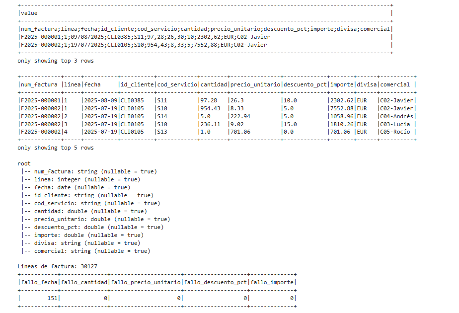
*TAREA B1: cabecera real del fichero, 5 facturas con los importes como `double`, esquema y recuento de conversiones fallidas.*

### CE1.c · Formato de almacenamiento

#### Comparativa de formatos (etapa 4 · parte C)

Escribimos las mismas 944 636 posiciones AIS válidas en seis formatos y medimos el tamaño en HDFS (sin
réplicas), el tiempo de escritura y dos consultas: una que recorre todas las filas
(`groupBy("mmsi").agg(avg("sog"))`) y otra que solo necesita 2 columnas (`select lat, lon where lat > 37.1`).

| Formato | Organización | MB | Escritura (s) | Consulta completa (s) | Consulta 2 col. (s) |
|---|---|---|---|---|---|
| CSV | filas, texto | 63,6 | 2,220 | 1,530 | 1,004 |
| JSON | filas, texto | 124,8 | 1,408 | 1,189 | 1,026 |
| Avro | filas, binario | 21,6 | 1,380 | 0,879 | 0,412 |
| ORC | columnar | 16,9 | 1,509 | 1,056 | 0,442 |
| Parquet snappy | columnar | 11,3 | 1,914 | 0,585 | 0,468 |
| Parquet zstd | columnar | **7,6** | **0,807** | **0,357** | **0,248** |

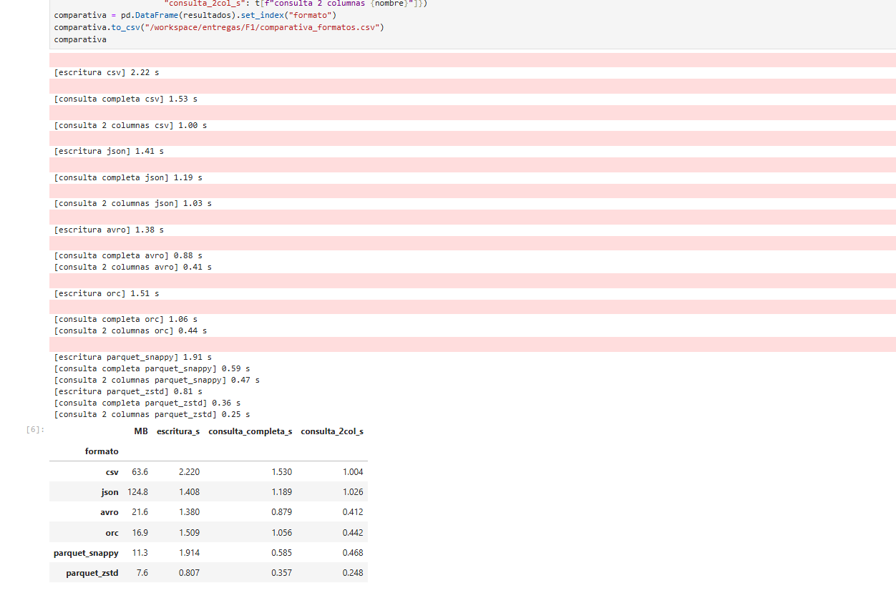
*Salida de la parte C: tiempos de cada formato y tabla de resultados (también en `comparativa_formatos.csv`).*

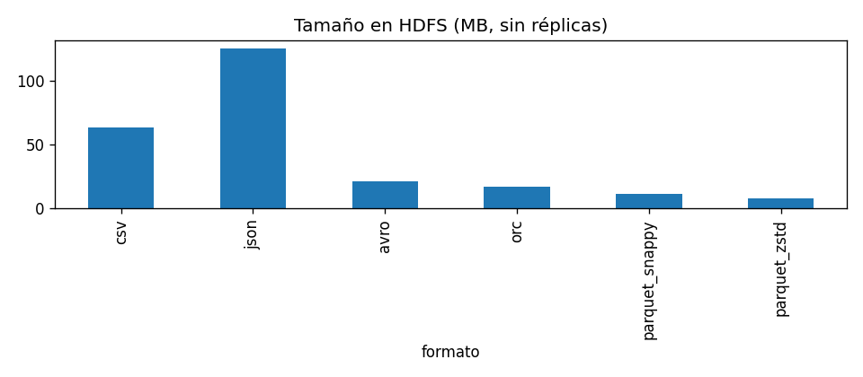
*Tamaño en HDFS: JSON ocupa 16 veces más que Parquet zstd.*

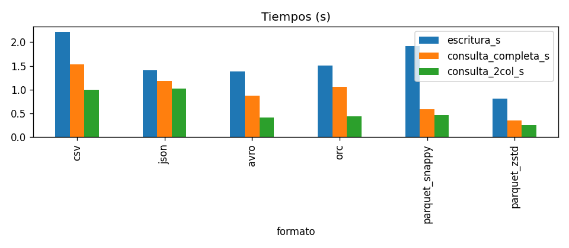
*Tiempos de escritura y de las dos consultas en la primera medición.*

#### TAREA C1 · Repetición y variabilidad

Repetimos las dos consultas tres veces por formato sobre los ficheros ya escritos (celda C1, guardada en
`comparativa_repeticiones.csv`):

| Formato | Completa mín. | Completa media | Completa máx. | 2 col. mín. | 2 col. media | 2 col. máx. |
|---|---|---|---|---|---|---|
| CSV | 0,598 | 0,648 | 0,684 | 0,467 | 0,498 | 0,546 |
| JSON | 0,672 | 0,766 | 0,919 | 0,537 | 0,576 | 0,612 |
| Avro | 0,393 | 0,409 | 0,438 | 0,297 | 0,309 | 0,323 |
| ORC | 0,241 | 0,264 | 0,280 | 0,181 | 0,224 | 0,255 |
| Parquet snappy | 0,220 | 0,239 | 0,266 | 0,179 | 0,195 | 0,220 |
| Parquet zstd | 0,208 | 0,238 | 0,259 | 0,181 | 0,202 | 0,223 |

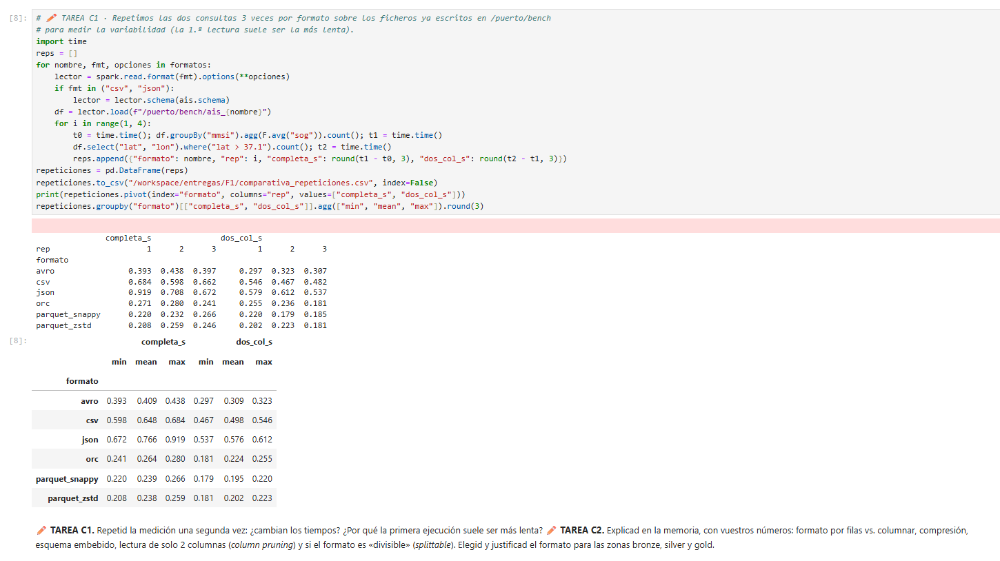
*Celda C1: tiempos de las tres repeticiones de cada consulta y resumen con mínimo, media y máximo.*

**Sí cambian los tiempos, y la primera vez es la más lenta.** La consulta completa sobre CSV tardó 1,53 s en la
primera medición y entre 0,60 y 0,68 s al repetirla; ORC pasó de 1,06 s a unos 0,26 s. La primera ejecución
es más lenta por dos motivos:
- La JVM de Spark está «fría»: la primera vez compila y optimiza el código de la consulta.
- Los DataNodes leen los bloques del disco; en las siguientes lecturas el sistema operativo ya los tiene en su
  caché de disco.

Spark no guarda los datos en memoria entre consultas salvo que se le pida con `.cache()`.

La variabilidad entre repeticiones es pequeña (±10–20 %), y **el orden de los formatos se mantiene**: los
columnares (ORC y Parquet) son siempre los más rápidos y JSON siempre el más lento. Entre snappy y zstd la
diferencia de tiempo está dentro del ruido (0,239 frente a 0,238 s de media), así que lo que los distingue es
el tamaño.

La escritura solo se mide una vez y también varía: en esta ejecución snappy tardó 1,91 s, mientras que en una
ejecución anterior en el mismo PC (17/11) tardó 0,56 s, y zstd 0,70 s. Por eso no basamos la decisión en una
única medición de escritura.

#### TAREA C2 · Explicación con nuestros números

- **Filas frente a columnas.** CSV, JSON y Avro guardan cada registro entero, uno tras otro; Parquet y ORC
  guardan juntos todos los valores de cada columna. Al ser del mismo tipo y parecidos se comprimen mucho mejor:
  Parquet zstd ocupa 7,6 MB frente a 63,6 MB de CSV (8 veces menos) y 124,8 MB de JSON (16 veces menos).
- ***Column pruning*.** En la consulta de 2 columnas, Parquet solo lee `lat` y `lon`: 0,248 s frente a
  1,004 s de CSV en la primera medición (4 veces más rápido) y 0,202 frente a 0,498 s de media al repetir. CSV
  tiene que leer y trocear cada línea entera aunque solo use dos campos.
- **Compresión.** zstd comprime más que snappy (7,6 frente a 11,3 MB, un 33 % menos) a cambio de algo más de
  CPU. Al leer menos bytes, consulta igual de rápido o más.
- **Esquema embebido.** Avro, Parquet y ORC guardan los tipos dentro del fichero; CSV y JSON no, y por eso al
  leerlos hay que pasarles el esquema (`lector.schema(ais.schema)` en la celda C) o inferirlo.
- **Divisible (*splittable*).** Parquet, ORC y Avro se pueden partir para que varios workers lean un mismo
  fichero en paralelo. CSV y JSON sin comprimir también; comprimidos con gzip no, y un solo worker tendría que
  leer el fichero entero.
- **Avro** es binario pero por filas: ocupa poco (21,6 MB) y escribe bien, pero analiza peor que los
  columnares. Encaja mejor para mensajes que se escriben de uno en uno, por ejemplo en Kafka.

**Elección por zona:**

| Zona | Formato | Motivo (con nuestros números) |
|---|---|---|
| bronze | Parquet zstd | El que menos ocupa (7,6 MB), el que menos tardó en escribir en esta medición (0,81 s) y de los más rápidos consultando. Snappy sería la alternativa si importara más ahorrar CPU al escribir que disco |
| silver | Parquet zstd | Se lee mucho más de lo que se escribe: mínimo tamaño y consultas de unos 0,2 s al repetirlas |
| gold | Parquet zstd | Tablas pequeñas consultadas por los informes: mismo motivo que silver |

#### Particionado y *partition pruning* (parte D)

La zona bronze de AIS está particionada por `fecha`: 61 carpetas, de `fecha=2025-06-01` a `fecha=2025-07-31`.
Al consultar un solo día:

```python
b.filter(F.col("fecha") == "2025-06-15").groupBy("estado_nav").count().explain()
```

```
+- FileScan parquet [estado_nav#3415,fecha#3419] Batched: true, DataFilters: [], Format: Parquet,
   Location: InMemoryFileIndex(1 paths)[hdfs://namenode:8020/puerto/bronze/ais],
   PartitionFilters: [isnotnull(fecha#3419), (fecha#3419 = 2025-06-15)],
   PushedFilters: [], ReadSchema: struct<estado_nav:int>
```

`PartitionFilters` demuestra que Spark solo abre la carpeta `fecha=2025-06-15` (1 de 61), y `ReadSchema` que
solo lee la columna `estado_nav`: se combinan el *partition pruning* y el *column pruning*. El resultado de ese
día: 6 746 posiciones navegando, 5 403 amarrados y 1 157 fondeados.

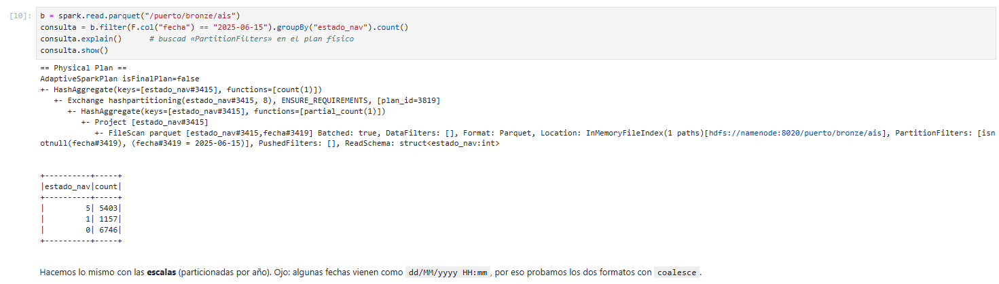
*Plan físico de la consulta de un día con `PartitionFilters` sobre la fecha pedida.*

#### TAREA D2 · El problema de los ficheros pequeños

El NameNode guarda en memoria RAM una entrada (unos 150 bytes) por cada fichero, carpeta y bloque de HDFS.
Si escribimos sin `repartition`, cada tarea de Spark escribe su propio fichero en cada fecha que le toca: con
8 tareas y 61 días podrían salir cerca de 500 ficheros diminutos en lugar de 61. A gran escala (por ejemplo,
un fichero por minuto, como pasaría con la ingesta continua) serían millones de entradas que llenan la memoria
del NameNode. Además, abrir muchos ficheros pequeños es más lento que leer pocos grandes. Por eso hacemos
`repartition("fecha")` antes de escribir: Spark junta en la misma tarea todas las filas de cada día y escribe
**un fichero por fecha**. Con el mismo criterio, los maestros se escriben con `coalesce(1)` (un solo fichero
por tabla) y las escalas se particionan por año, no por día.

### CE1.d · Procesamiento de los datos almacenados

#### Zona bronze de todas las fuentes (etapa 5 · parte D y TAREA D1)

Todas las tablas bronze se leen con esquema declarado, convierten fechas y números a su tipo y llevan columnas
de linaje: `_fichero_origen` (de qué fichero vino cada fila) y `_ingestado` (cuándo se cargó).

| Tabla bronze | Origen | Filas | Particionado | Tratamiento de tipos |
|---|---|---|---|---|
| `/puerto/bronze/ais` | JSON Lines | 944 636 | `fecha` (61 días) | `ts` ISO 8601 en UTC → timestamp; sin las 735 corruptas |
| `/puerto/bronze/escalas` | CSV | (no contado) | `anio` (2024, 2025) | `eta`, `ata` y `atd` en dos formatos con `coalesce` |
| `/puerto/bronze/sensores` | CSV formato largo | 1 348 728 | `fecha` (día local) | `ts` con desfase `+02:00` → timestamp; `valor` → double |
| `/puerto/bronze/contenedores` | CSV | 400 182 | sin particionar | `ts` → timestamp; `peso_bruto_kg` y `temp_consigna_c` → double |
| `/puerto/bronze/maestros/muelles` | CSV | 12 | 1 fichero | calado, longitud y coordenadas → double |
| `/puerto/bronze/maestros/navieras` | CSV | 40 | 1 fichero | `flota` → integer |
| `/puerto/bronze/maestros/buques` | CSV | 320 | 1 fichero | arqueo, eslora, manga y calado → double |

Antes de declarar cada esquema mostramos las primeras líneas reales de cada fichero, porque Spark asigna las
columnas por posición. Así comprobamos, por ejemplo, que en sensores el orden es
`ts, id_sensor, variable, valor, unidad`. Después de convertir contamos los valores que no se han podido pasar
a su tipo: **0 fallos** en sensores (`ts`, `valor`) y en contenedores (`ts`, `peso_bruto_kg`,
`temp_consigna_c`).

```python
esquema_sensores = T.StructType([
    T.StructField("ts", T.StringType()),          # hora local con desfase +02:00
    T.StructField("id_sensor", T.StringType()),
    T.StructField("variable", T.StringType()),
    T.StructField("valor", T.StringType()),       # se lee como texto y se convierte (así se ven los fallos)
    T.StructField("unidad", T.StringType()),
])
sensores_bronze = (spark.read.schema(esquema_sensores).option("header", True).csv("/puerto/raw/sensores/")
    .withColumn("fecha", F.to_date(F.substring("ts", 1, 10)))   # día local, igual que el nombre del fichero
    .withColumn("ts", F.to_timestamp("ts"))                     # el +02:00 se respeta: instante correcto
    .withColumn("valor", F.col("valor").cast("double"))
    .withColumn("_fichero_origen", F.input_file_name())
    .withColumn("_ingestado", F.current_timestamp()))
(sensores_bronze.repartition("fecha")
    .write.mode("overwrite").partitionBy("fecha").parquet("/puerto/bronze/sensores"))
```

La fecha de partición se toma de los 10 primeros caracteres de `ts` (el día local del puerto), no del instante
convertido, para que cada carpeta coincida con el fichero diario de origen.

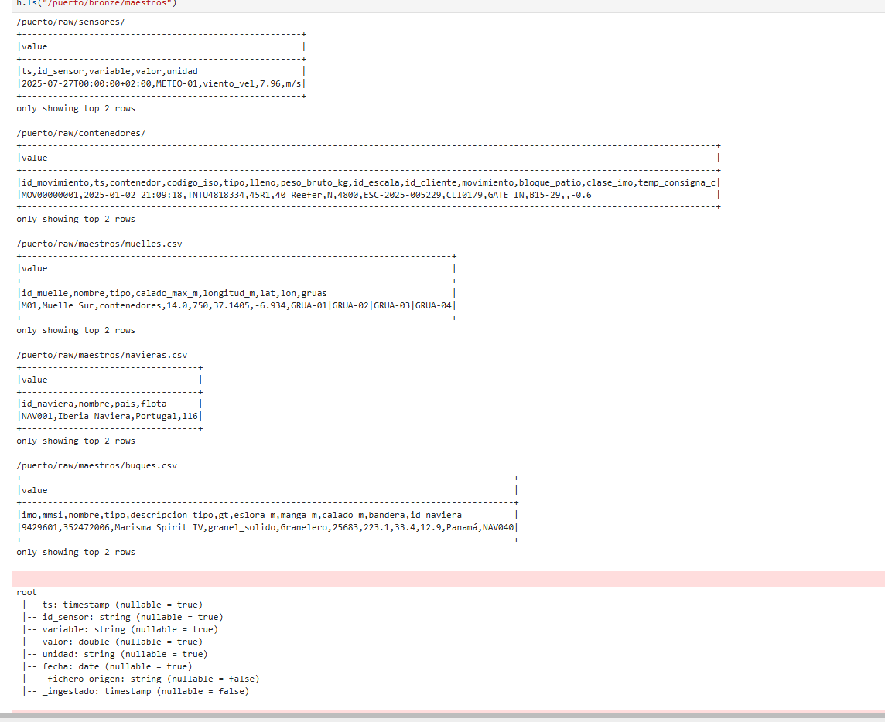
*Primeras líneas reales de sensores, contenedores y los tres maestros, y esquema resultante de sensores.*

```
Bronze sensores · filas: 1348728 · fallos de conversión: {'ts': 0, 'valor': 0}
Bronze contenedores · filas: 400182 · fallos de conversión: {'ts': 0, 'peso_bruto_kg': 0, 'temp_consigna_c': 0}
Bronze muelles · filas: 12
Bronze navieras · filas: 40
Bronze buques · filas: 320
```

```powershell
.\bda.ps1 hdfs dfs -ls /puerto/bronze
```

```
drwxr-xr-x   - hadoop supergroup          0 2026-11-18 18:03 /puerto/bronze/ais
drwxr-xr-x   - hadoop supergroup          0 2026-11-18 18:03 /puerto/bronze/contenedores
drwxr-xr-x   - hadoop supergroup          0 2026-11-18 18:03 /puerto/bronze/escalas
drwxr-xr-x   - hadoop supergroup          0 2026-11-18 18:03 /puerto/bronze/maestros
drwxr-xr-x   - hadoop supergroup          0 2026-11-18 18:03 /puerto/bronze/sensores
```

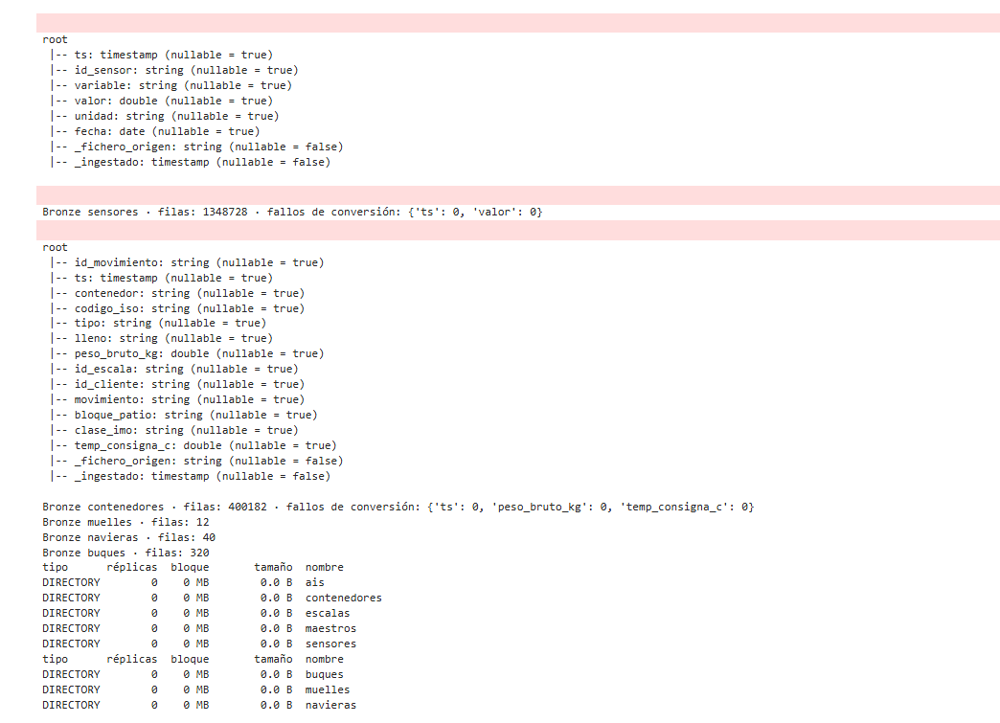
*Esquemas de sensores y contenedores, recuento de filas sin fallos de conversión y listado de `/puerto/bronze` con las cinco fuentes y los tres maestros.*

#### Consultas de negocio (etapa 6 · parte E y TAREA E1)

Registramos las tablas bronze como vistas (`createOrReplaceTempView`) y las consultamos con Spark SQL. Cada
resultado se guarda en gold con `.write.mode("overwrite").parquet("/puerto/gold/<tabla>")`. Las horas se
calculan pasando las fechas a segundos con `unix_timestamp` y dividiendo entre 3600.

**Consultas dadas.** `f1_trafico_mensual` (escalas y miles de toneladas por mes y tipo de tráfico) y
`f1_espera_trimestral` (horas medias entre la llegada a la bahía, `eta`, y el atraque, `ata`). Resultado
para los portacontenedores:

```
+------------+----+---------+--------------+-------+
|tipo_trafico|anio|trimestre|espera_media_h|escalas|
+------------+----+---------+--------------+-------+
|contenedores|2024|        1|           4.6|    112|
|contenedores|2024|        2|           5.1|    115|
|contenedores|2024|        3|           4.5|     87|
|contenedores|2024|        4|           5.4|    112|
|contenedores|2025|        1|           5.1|    110|
|contenedores|2025|        2|           5.5|    104|
|contenedores|2025|        3|          15.6|    111|
|contenedores|2025|        4|           8.1|    109|
+------------+----+---------+--------------+-------+
```

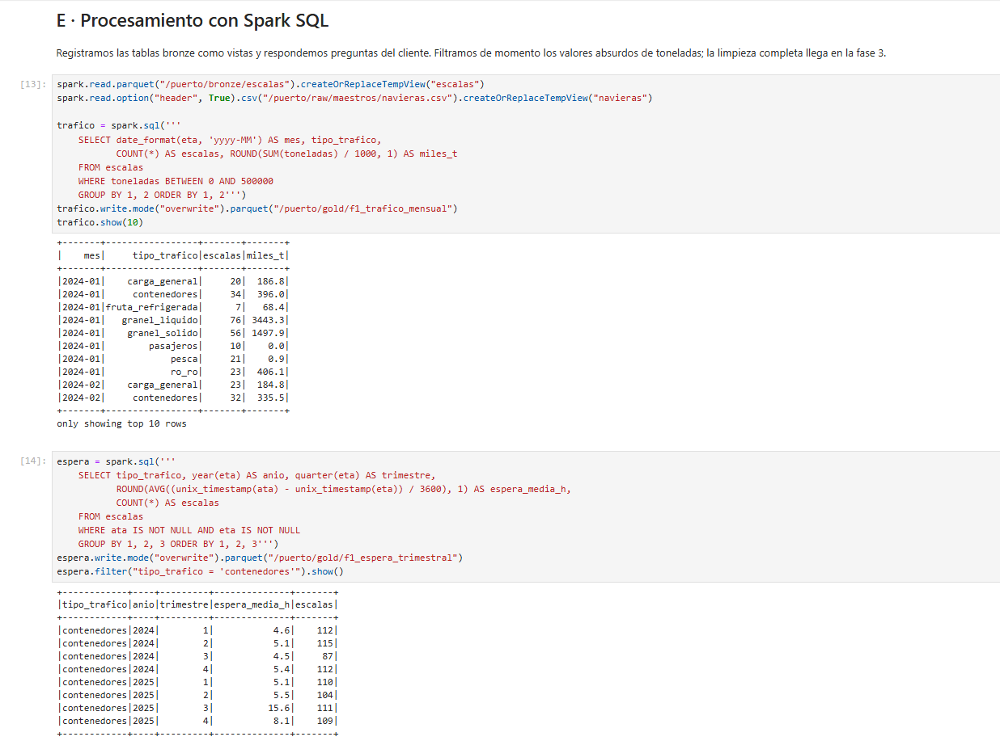
*Consultas dadas de tráfico mensual y espera trimestral, guardadas en gold.*

##### Consulta 1 · Las 10 navieras con más toneladas en 2025 → `f1_top_navieras`

**Qué responde:** qué clientes navieros mueven más mercancía en el puerto, para priorizar la atención comercial.

```sql
SELECT n.nombre AS naviera, SUM(e.toneladas) AS total_toneladas
FROM escalas e
JOIN navieras n ON e.id_naviera = n.id_naviera
WHERE year(e.eta) = 2025 AND e.toneladas BETWEEN 0 AND 500000
GROUP BY n.nombre
ORDER BY total_toneladas DESC
LIMIT 10
```

| Naviera | Toneladas 2025 |
|---|---|
| Azores Naviera | 3 597 800 |
| Atlántica Naviera | 3 560 320 |
| Tinto Maritime | 2 898 361 |
| Iberia Maritime | 2 839 039 |
| Mare Nostrum Maritime | 2 783 718 |
| Canarias Maritime | 2 769 536 |
| Levante Shipping | 2 738 115 |
| Blue Wave Maritime | 2 696 156 |
| Cabo Verde Maritime | 2 692 974 |
| Blue Wave Carriers | 2 533 465 |

Une las escalas con el maestro de navieras para mostrar el nombre en lugar del código. Se filtra
`toneladas BETWEEN 0 AND 500000` porque hay valores imposibles (negativos o desorbitados) que falsearían la
suma; la limpieza completa se hará en la fase 3.

##### Consulta 2 · Ocupación de cada muelle por mes → `f1_ocupacion_muelles`

**Qué responde:** cuántas horas al mes ha estado ocupado cada muelle (del atraque `ata` a la salida `atd`),
para detectar muelles saturados.

```sql
SELECT id_muelle, date_format(ata, 'yyyy-MM') AS mes,
       ROUND(SUM((unix_timestamp(atd) - unix_timestamp(ata)) / 3600), 1) AS horas_ocupado
FROM escalas
WHERE ata IS NOT NULL AND atd IS NOT NULL
GROUP BY id_muelle, mes
ORDER BY mes DESC, horas_ocupado DESC
```

```
(extracto de las primeras filas)
|id_muelle|    mes|horas_ocupado|
|      M12|2026-01|         41.9|
|      M06|2026-01|         28.4|
|      M02|2025-12|       1850.5|
|      M03|2025-12|       1257.0|
|      M04|2025-12|        850.9|
|      M01|2025-12|        807.7|
```

Dos observaciones:
- Aparecen meses de **2026**: son buques que llegaron a finales de diciembre de 2025 y atracaron ya en enero.
- **M02 suma 1 850 horas en diciembre**, más de las 744 que tiene el mes. Puede deberse a que atracan varios
  buques a la vez en el mismo muelle o a salidas mal registradas. Hay que revisarlo en la fase 3 antes de usar
  esta tabla para decisiones.

##### Consulta 3 · Velocidad media por estado de navegación (AIS) → `f1_velocidad_por_estado`

**Qué responde:** a qué velocidad se mueven los buques según su estado AIS, para validar que el estado
declarado es coherente con el movimiento real.

```sql
SELECT estado_nav, ROUND(AVG(sog), 2) AS velocidad_media_nudos, COUNT(*) AS registros
FROM ais
WHERE sog > 0
GROUP BY estado_nav
ORDER BY velocidad_media_nudos DESC
```

```
|estado_nav|velocidad_media_nudos|registros|
|         0|                10.91|   592536|
|         5|                 0.15|   226272|
|         1|                 0.15|    40557|
```

Los buques navegando (estado 0) van a casi 11 nudos (unos 20 km/h); los amarrados (5) y fondeados (1) apenas
se mueven (0,15 nudos, la deriva normal de un barco parado), así que el estado declarado es coherente.

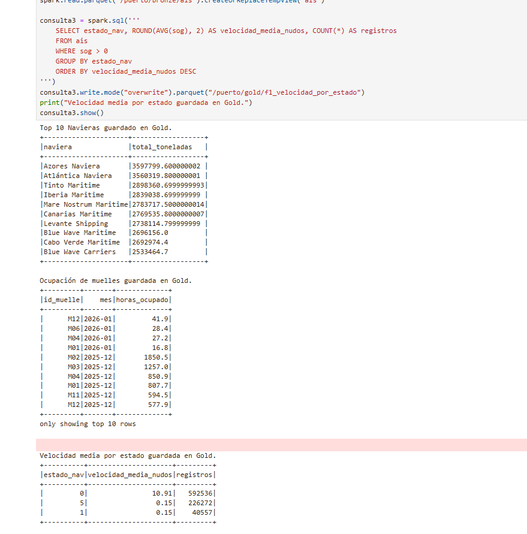
*Resultados de las consultas 1 (navieras), 2 (muelles) y 3 (velocidad por estado), guardadas en gold.*

##### Consulta 4 · Buques distintos por día con media móvil de 7 días (AIS) → `f1_buques_dia_ais`

**Qué responde:** cuántos buques distintos hay cada día en la zona del puerto en la segunda quincena de junio y
cuál es la tendencia semanal, sin el ruido de un día concreto.

```sql
SELECT fecha, buques,
       ROUND(AVG(buques) OVER (ORDER BY fecha ROWS BETWEEN 6 PRECEDING AND CURRENT ROW), 1) AS media_7d
FROM (SELECT fecha, COUNT(DISTINCT mmsi) AS buques
      FROM ais
      WHERE fecha BETWEEN '2025-06-15' AND '2025-06-30'
      GROUP BY fecha)
ORDER BY fecha
```

```
FileScan parquet [mmsi#4485,fecha#4495] ... PartitionFilters: [isnotnull(fecha#4495),
  (fecha#4495 >= 2025-06-15), (fecha#4495 <= 2025-06-30)], ReadSchema: struct<mmsi:string>

(extracto: 4 de las 16 filas)
|     fecha|buques|media_7d|
|2025-06-15|    31|    31.0|
|2025-06-20|    37|    34.0|
|2025-06-23|    22|    32.1|
|2025-06-30|    40|    34.4|
```

Usa una **función de ventana** (media móvil de 7 filas) y está **optimizada**: como filtra por la columna de
partición, `PartitionFilters` muestra que Spark solo lee 16 de las 61 carpetas, y `ReadSchema` que solo lee
`mmsi`. Entre 22 y 40 buques diarios; la media semanal se mantiene estable en torno a 30–34.

Spark avisa con `No Partition Defined for Window operation`: la ventana no tiene `PARTITION BY` y lleva todos
los datos a una sola partición. Aquí no es problema, porque la ventana se aplica después de agrupar y solo
recibe 16 filas. Con muchos datos habría que añadir un `PARTITION BY` (por ejemplo, por mes).

##### Consulta 5 · Horas con viento por encima de 14 m/s (sensores) → `f1_viento_gruas`

**Qué responde:** qué días y cuántas horas sopló el viento por encima de 14 m/s, el umbral a partir del cual
paran las grúas según el diccionario de datos. Sirve para saber si el mal tiempo explica retrasos en la
operativa.

```sql
SELECT fecha,
       ROUND(SUM(CASE WHEN valor > 14 THEN 1 ELSE 0 END) / 60, 1) AS horas_viento_fuerte,
       ROUND(MAX(valor), 1) AS viento_max_ms
FROM sensores
WHERE id_sensor = 'METEO-01' AND variable = 'viento_vel' AND valor BETWEEN 0 AND 60
GROUP BY fecha
HAVING horas_viento_fuerte > 0
ORDER BY horas_viento_fuerte DESC
```

```
Días con viento por encima de 14 m/s: 4
|     fecha|horas_viento_fuerte|viento_max_ms|
|2025-07-10|                7.0|         17.3|
|2025-06-23|                5.9|         16.9|
|2025-06-06|                1.5|         15.3|
|2025-07-27|                0.8|         15.8|
```

METEO-01 mide cada minuto, así que los minutos por encima del umbral entre 60 dan las horas. El filtro
`valor BETWEEN 0 AND 60` descarta lecturas imposibles del anemómetro. En los 60 días con datos hubo solo
4 días con viento fuerte, 15,2 horas en total.

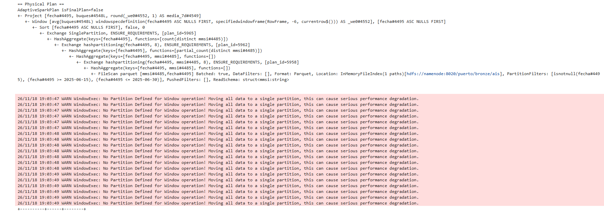
*Plan de la consulta 4 con `PartitionFilters` sobre el rango de fechas y aviso de Spark sobre la ventana sin partición.*

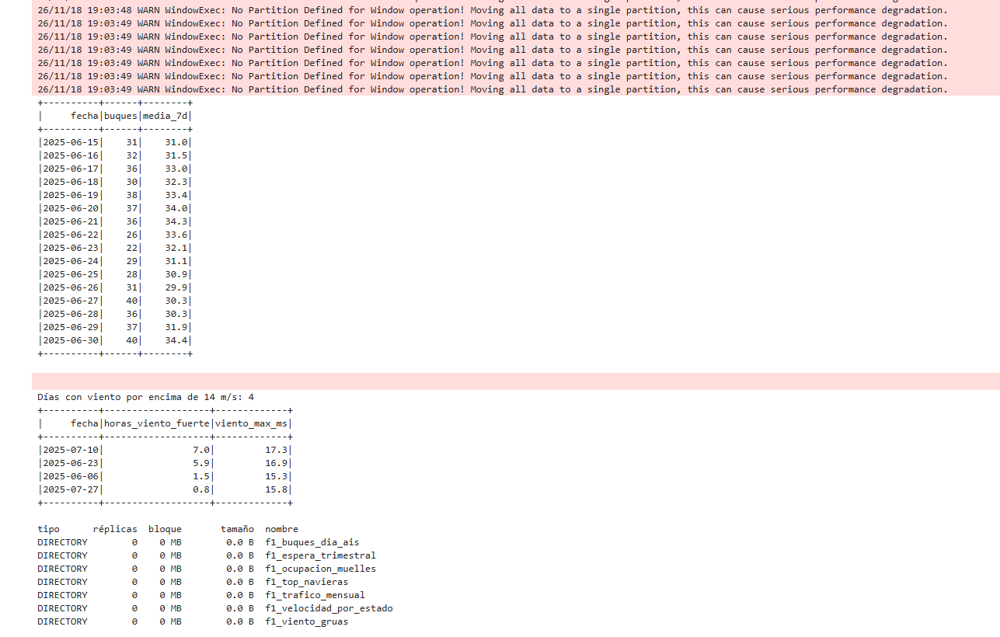
*Resultados de las consultas 4 (buques por día) y 5 (viento fuerte) y listado de `/puerto/gold`.*

**Tablas en gold:** 7 tablas (2 dadas + 5 propias).

```
f1_buques_dia_ais   f1_espera_trimestral   f1_ocupacion_muelles   f1_top_navieras
f1_trafico_mensual  f1_velocidad_por_estado   f1_viento_gruas
```

### CE1.e · Presentación al cliente

---

**Informe para la dirección del Puerto de Huelva · Esperas de los portacontenedores en 2025**

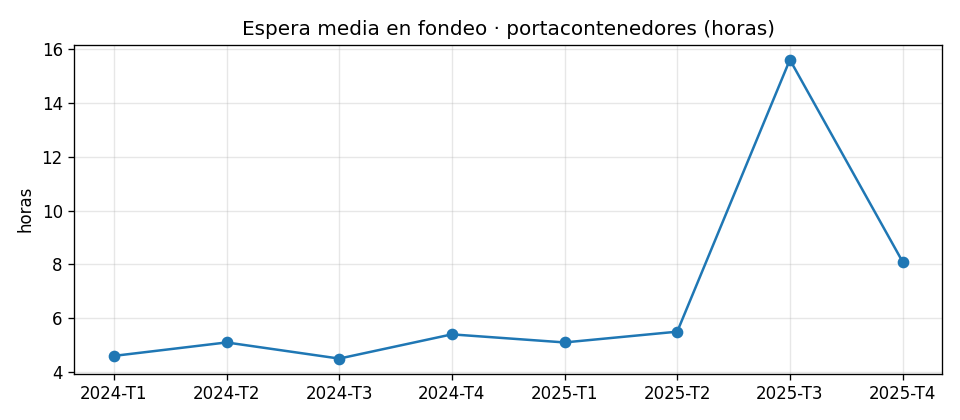
*Horas medias que espera un portacontenedores desde que llega a la bahía hasta que puede atracar, por trimestre.*

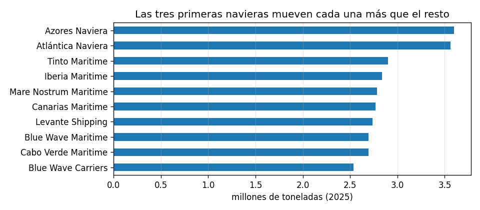
*Millones de toneladas movidas en 2025 por las diez navieras con más actividad.*

**Conclusiones**

1. **La espera de los portacontenedores se triplicó en el verano de 2025.** Durante año y medio esperaban unas
   5 horas para atracar. Entre julio y septiembre de 2025 la espera media llegó a **15,6 horas**. En el último
   trimestre bajó a 8 horas, pero sigue siendo un 60 % más de lo habitual.
2. **No llegaron más barcos: el problema está dentro del puerto.** En ese trimestre hubo 111 escalas de
   portacontenedores, casi las mismas que en los anteriores (104–115). El resto de barcos también esperó algo
   más en verano (los graneleros pasaron de unas 7 a unas 10 horas), pero solo los portacontenedores
   triplicaron su espera.
3. **Los clientes más importantes son los más expuestos.** Azores Naviera (3,6 millones de toneladas),
   Atlántica Naviera (3,6) y Tinto Maritime (2,9) son las navieras que más mercancía movieron en 2025. Cada
   hora de espera les supone costes y retrasos, y hay riesgo de que desvíen escalas a otros puertos.

**Recomendación**

Revisar antes del próximo verano la organización de los muelles de contenedores: comprobar qué muelles y
turnos estuvieron saturados entre julio y septiembre y reforzarlos (más horas de trabajo o un segundo muelle
para contenedores en temporada alta), con el objetivo de volver a esperas por debajo de 6 horas.

**Preguntas que probablemente nos hará la dirección**

- *¿Ha sido por el mal tiempo?* No parece. Con viento fuerte las grúas se paran, pero en junio y julio solo
  hubo 4 días de viento fuerte, unas 15 horas en total. Eso no explica que cada barco esperara de media
  10 horas más durante tres meses.
- *¿Se ha solucionado ya?* En parte: en el último trimestre la espera bajó a 8 horas, pero todavía no ha
  vuelto a las 5 horas habituales.
- *¿Cuánto nos cuesta?* Podemos medir las horas perdidas. Para pasarlas a euros necesitaríamos el coste por
  hora de un barco parado, que nos tendrían que facilitar las navieras.

---

## 3. Problemas encontrados y cómo los resolvimos

| Problema / mensaje de error | Causa | Solución | Fuente consultada |
|---|---|---|---|
| `python: not found` al hacer la ingesta | El script usaba el comando `python` en lugar de `python3` | Usar `python3` | Manual de atascos |
| `invalid option name` en `ingesta.sh` | El fichero tenía finales de línea de Windows (CRLF) y bash no los acepta | Añadir `.gitattributes` y renormalizar los ficheros | Compañero / profesor |
| `NameError: name 'escalas_raw' is not defined` | No se había ejecutado la celda anterior en Jupyter | Ejecutar las celdas en orden desde arriba | Conocimiento propio |
| `Executor heartbeat timed out` en las salidas del cuaderno | El PC se suspendió con la sesión de Spark abierta y los executors se dieron por perdidos | Reiniciar el kernel y ejecutar el cuaderno entero de nuevo | Manual de atascos |
| `NameError: name 'espera' is not defined` en la parte F | Se reinició el kernel y se ejecutó la parte F sin la parte E | *Kernel > Restart Kernel and Run All Cells* antes de entregar | Hoja de ruta, etapa 8 |
| La TAREA B1 con 6 columnas daba importes incorrectos sin dar error | Con esquema explícito Spark asigna las columnas por posición, y el fichero tiene 11 | Mostrar la cabecera real con `spark.read.text(...)` y declarar las 11 columnas en su orden | `DICCIONARIO_DATOS.md` |
| Fechas de sensores vacías tras convertir en una primera versión de D1 | El esquema tenía `ts` e `id_sensor` intercambiados | Seguir el orden real: `ts, id_sensor, variable, valor, unidad` | `DICCIONARIO_DATOS.md` |
| `display()` en la TAREA B1 mostraba `DataFrame[...]` y no las filas | `display` solo enseña el tipo de un DataFrame de Spark | Usar `.show(5)` | Documentación de PySpark |
| Aviso `LF will be replaced by CRLF` al hacer `git add` | Los ficheros generados en el contenedor (Linux) tienen finales LF; Git en Windows avisa de la conversión | Ninguna: no afecta a notebooks ni CSV (solo importaría en scripts `.sh`) | Documentación de Git |

## 4. Conclusiones y mejoras propuestas

Hemos aprendido a diseñar un lago de datos por zonas y a construirlo de verdad: cargar los datos en HDFS de
forma repetible, leerlos sin que Spark se invente los tipos y no perder en silencio los datos defectuosos (735
líneas AIS rotas y 151 fechas de factura mal formadas). La comparativa nos ha demostrado con números propios
que el formato importa: el mismo dato ocupa 124,8 MB en JSON y 7,6 MB en Parquet zstd, y se consulta varias
veces más rápido. También hemos comprobado que una sola medición de tiempos engaña: hay que repetir. Y hemos
visto que particionar por fecha y evitar ficheros pequeños es lo que mantiene las consultas rápidas cuando los
datos crecen.

Mejoras propuestas:
- Implementar la ingesta continua de AIS y sensores con Kafka y Structured Streaming, con compactación nocturna.
- Mover las líneas `_corrupto` y las fechas que no se convierten a la cuarentena, con el motivo del rechazo.
- Validar las toneladas y las horas de atraque en silver en lugar de filtrarlas en cada consulta.
- Configurar el tamaño de bloque también en el cliente de Spark para que sus ficheros usen bloques de 32 MB.

## 5. Declaración de uso de herramientas

| Herramienta / fuente | Para qué | Partes afectadas |
|---|---|---|
| ChatGPT | Resolver dudas de sintaxis SQL y PySpark, y revisar el formato Markdown | Memoria (redacción) y cuaderno (corrección de errores) |
| Claude (Anthropic) | Revisión del trabajo frente a la hoja de ruta y la rúbrica; corrección de los esquemas de B1 y D1; celdas de repetición (C1), consultas 4 y 5 y gráfico de navieras; reorganización de la memoria y de la arquitectura | Memoria, `ARQUITECTURA.md`, cuaderno (B1, C1, D1, E1, F) |
| Apuntes de clase y `DICCIONARIO_DATOS.md` | Diseño de las zonas y esquemas de cada fuente | Arquitectura, memoria y cuaderno |
