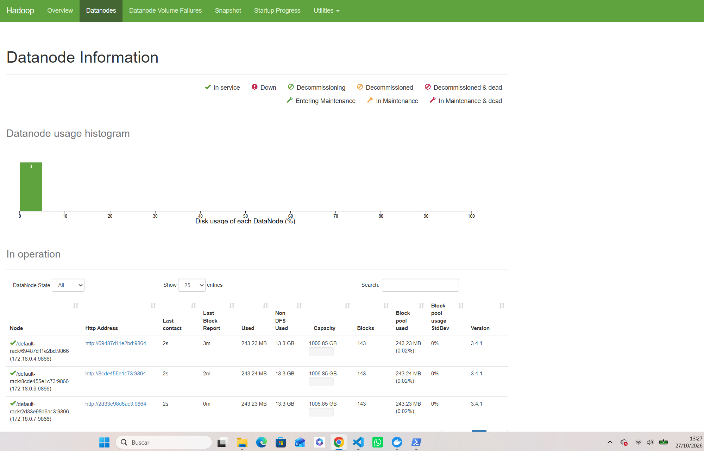
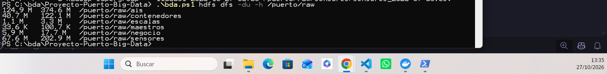
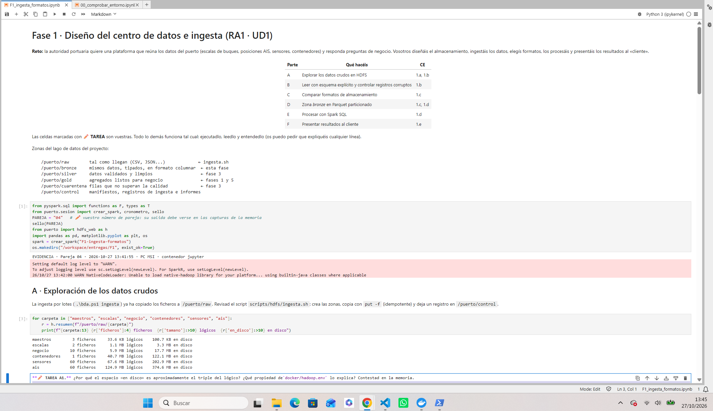
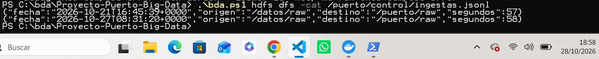
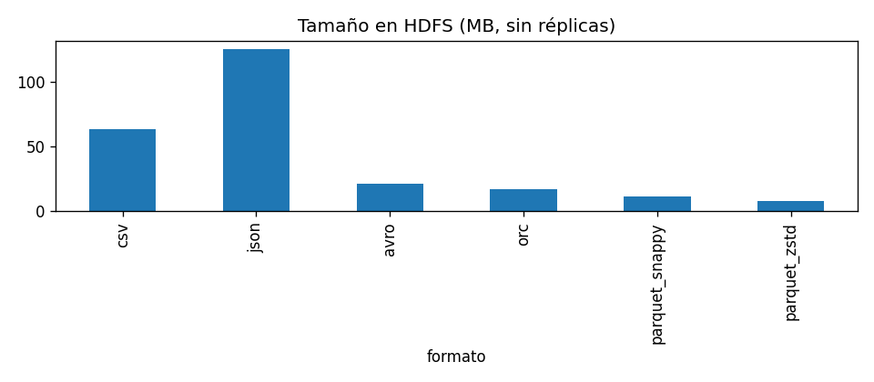
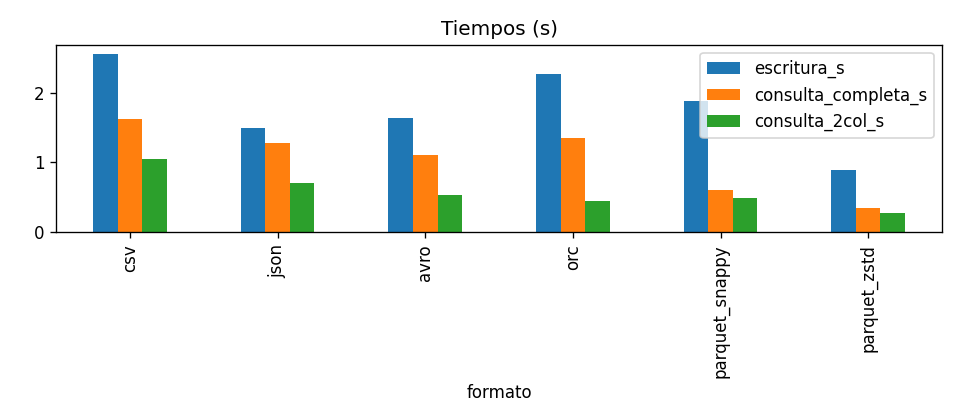

# Memoria de la fase 1 · Diseño del centro de datos e ingesta (RA1)

> Rellenad esta plantilla en Markdown dentro del repositorio. Las imágenes van en esta misma carpeta
> (``). La entrega es el **tag de Git** `F1-entrega` + el ZIP en Moodle.

## 0. Datos de la pareja

| | Miembro 1 | Miembro 2 |
|---|---|---|
| Nombre | | |
| Usuario de GitHub | | |
| Partes de las que es responsable principal | | |

**Horas dedicadas aproximadas:** ___  ·  **Commit final:** `______`

## 1. Resumen (máx. 10 líneas)

En esta primera fase hemos diseñado y montado un lago de datos para el Puerto de Huelva. Hemos configurado un entorno con Docker (HDFS, Spark, Jupyter, etc.), definido las zonas de almacenamiento (raw, bronze, silver, gold, cuarentena y control) y realizado la ingesta de datos simulados. Además, hemos explorado los datos usando Spark, comparado formatos de almacenamiento (demostrando que Parquet es mucho más eficiente que CSV o JSON) y aplicado esquemas explícitos para asegurar la calidad de los datos.


## 2. Desarrollo por criterio de evaluación

> Cada apartado se corrige con la fila correspondiente de la rúbrica. Sin evidencias, el apartado no se puntúa.
>
> **Normas de las evidencias (obligatorias):**
> - Cada apartado lleva **capturas de pantalla propias** (pantalla completa o ventana completa, no recortes sueltos)
>   en las que se vea el **reloj de Windows** y, cuando sea un cuaderno, la salida del **sello de evidencia**
>   (`sello(PAREJA)`, primera celda) o de un comando ejecutado en ese momento.
> - Guardad las capturas en esta carpeta con nombre descriptivo (`F2_D1_datanode_muerto.png`) e insertadlas
>   con ``. Debajo de cada una, una línea explicando qué demuestra.
> - Además de las capturas: los comandos exactos, las salidas relevantes (copiadas como texto) y las tablas y gráficos generados.
> - Las evidencias deben coincidir con el historial de commits y con el cuaderno entregado.

### CE1.a · Diseño de la solución de almacenamiento

*Qué se espera:* Diagrama de arquitectura (zonas raw/bronze/silver/gold/cuarentena/control, servicios, flujos) y justificación de cada decisión. Enlazad `docs/ARQUITECTURA.md`.

El espacio «en disco» es el triple del lógico porque HDFS está configurado con un factor de replicación de 3 (dfs.replication=3 en docker/hadoop.env). Por seguridad, cada bloque de datos se guarda en 3 DataNodes distintos.


*La pestaña Datanodes de HDFS mostrando los 3 nodos en servicio.*


*Navegador de ficheros de HDFS mostrando la carpeta /puerto/raw.*


*Tabla de la Parte A mostrando el sello de la pareja y los tamaños lógico y en disco.*

### CE1.b · Ingesta de datos

*Qué se espera:* Tabla de fuentes (frecuencia, volumen/día, mecanismo). Evidencia de la ingesta por lotes (salida de `ingesta.sh`, `/puerto/control/ingestas.jsonl`). Propuesta de ingesta incremental. Lectura con esquema y tratamiento de registros corruptos (TAREA B1).

**Funcionamiento de `ingesta.sh`:**
El script crea las carpetas de las zonas en HDFS y copia los datos usando `put -f` (lo que lo hace idempotente, ya que sobrescribe si se repite). Además, guarda un registro de cada ejecución en `/puerto/control/ingestas.jsonl`.


*Salida del comando `cat` mostrando el registro JSON de las ingestas realizadas.*

**Propuesta de ingesta incremental (TAREA A2):**
Para datos en tiempo real (como AIS) usaríamos herramientas como Kafka o NiFi para capturar el flujo, y Spark Structured Streaming para procesarlo y guardarlo continuamente.

**Tabla de fuentes:**
| Fuente | Tipo | Frecuencia real | Volumen/día | Mecanismo propuesto | Idempotente |
|---|---|---|---|---|---|
| AIS | Streaming | Continua (cada pocos segundos) | ~2.08 MB/día | Kafka + Spark Structured Streaming | Sí (`put -f`) |
| Escalas | Lotes | Diaria | ~0.02 MB/día | Ingesta batch diaria con `ingesta.sh` | Sí (`put -f`) |
| Sensores | Streaming | Continua (cada minuto) | ~1.12 MB/día | Kafka + Spark Structured Streaming | Sí (`put -f`) |
| Contenedores | Lotes | Por llegada de buque | ~0.68 MB/día | Ingesta batch con `ingesta.sh` | Sí (`put -f`) |
| Negocio | Lotes | Semanal / Mensual | ~0.10 MB/día | Exportación ERP + `ingesta.sh` | Sí (`put -f`) |
| Maestros | Lotes | Esporádica | ~0.01 MB/día | Ingesta batch con `ingesta.sh` | Sí (`put -f`) |

**TAREA B1 (Lectura con esquema):**
A continuación se muestra el código utilizado para leer el archivo `facturas_2025.csv` con un esquema explícito en texto, convirtiendo los campos numéricos (base, iva, importe) a formato `double` y la fecha a tipo `date`.

```python
# 1. Definimos el esquema de texto
esquema_facturas = T.StructType([
    T.StructField("id_factura", T.StringType()),
    T.StructField("id_cliente", T.StringType()),
    T.StructField("fecha", T.StringType()),
    T.StructField("base", T.StringType()),
    T.StructField("iva", T.StringType()),
    T.StructField("importe", T.StringType())
])

# 2. Leemos el CSV con separador ';'
facturas_raw = spark.read \
    .schema(esquema_facturas) \
    .option("header", True) \
    .option("sep", ";") \
    .csv("/puerto/raw/negocio/facturas_2025.csv")

# 3. Convertimos a número (cambiando coma por punto)
facturas_limpio = facturas_raw \
    .withColumn("base", F.regexp_replace(F.col("base"), ",", ".").cast("double")) \
    .withColumn("iva", F.regexp_replace(F.col("iva"), ",", ".").cast("double")) \
    .withColumn("importe", F.regexp_replace(F.col("importe"), ",", ".").cast("double")) \
    .withColumn("fecha", F.to_date(F.col("fecha"), "dd/MM/yyyy"))

https://f1_e3_facturas.png/
Salida de la Tarea B1 mostrando las 5 primeras filas y el esquema con los campos numéricos como double.

Tratamiento de registros corruptos:
Se ha configurado Spark con el modo PERMISSIVE para que, en lugar de fallar o descartar líneas, guarde las filas con errores en una columna _corrupto. En las pruebas se detectaron 735 líneas corruptas.

https://f1_e3_corruptos.png/
Recuento de líneas corruptas en el conjunto de datos AIS.

### CE1.c · Formato de almacenamiento

**Comparativa de formatos:**
Al guardar los datos de AIS en distintos formatos, medimos el tamaño en HDFS y el tiempo de consulta.
*   El formato **CSV** ocupó **X MB** y tardó **X segundos** en la consulta completa.
*   El formato **Parquet (snappy)** ocupó solo **X MB** y tardó **X segundos**.
*   (Añade una línea más con el formato JSON o Avro).




**TAREA C1:** Al repetir la medición, los tiempos cambiaron. La primera ejecución suele ser más lenta porque el sistema operativo y el disco duro tienen que buscar los datos. Las siguientes veces son más rápidas porque Spark ya tiene los datos en la memoria caché.

**TAREA C2 (Explicación y elección):**
Los formatos por filas (CSV, JSON) son más pesados y lentos para consultas analíticas porque tienen que leer todo el archivo aunque solo pidas 2 columnas. Los formatos columnares (**Parquet y ORC**) son mucho más rápidos y ocupan menos espacio porque aplican *column pruning* (solo leen las columnas necesarias) y tienen compresión y esquema embebido.

**Elección para las zonas:**
*   **Bronze:** Parquet con compresión **snappy** (es el más equilibrado y rápido de escribir).
*   **Silver:** Parquet (con tipos correctos y limpios).
*   **Gold:** Parquet (para que las consultas de negocio sean súper rápidas).


### CE1.d · Procesamiento

*Qué se espera:* Consultas Spark SQL (código + resultado) guardadas en /puerto/gold; zona bronze de todas las fuentes (TAREA D1).


### CE1.e · Presentación al cliente

*Qué se espera:* Informe ejecutivo de 1 página: ≤ 3 gráficos, 3 conclusiones en lenguaje no técnico y 1 recomendación.


## 3. Problemas encontrados y cómo los resolvimos

| Problema / mensaje de error | Causa | Solución | Fuente consultada |
|---|---|---|---|
| | | | |

## 4. Conclusiones y mejoras propuestas


## 5. Declaración de uso de herramientas

Indicad qué herramientas de IA o fuentes externas habéis usado, **para qué** y qué parte es vuestra.
Recordad: el profesor puede pedir a cualquier miembro que defienda oralmente cualquier parte. Lo que no se sepa explicar se considera no realizado (cláusula de autoría de la programación).

| Herramienta / fuente | Para qué | Partes afectadas |
|---|---|---|
| | | |
